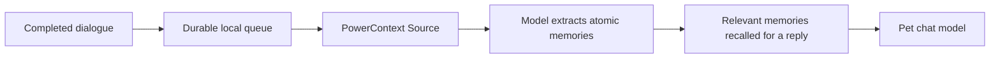

# dsh-pet-powercontext

**An animated desktop companion that can chat, react to your work, and remember what matters to you.**

English · [简体中文](README.zh.md)

<p>
  
  
  
</p>

Drag it around, talk to it, let it keep you company while you work. dsh-pet runs inside **DeepSeek Harness (DSH)** or as a **standalone app**. It combines an animated pet, configurable personality, chat, voice, and small everyday tools. Optional **PowerContext 1.5.0** integration gives each pet a persistent memory beyond its recent conversation window.

This repository builds on [PC2005-cloud/dsh-pet](https://github.com/PC2005-cloud/dsh-pet). To try the PowerContext integration described here, build this branch from source. The upstream npm package and downloadable releases may not include these changes.

## What the pet does

| Capability | What you can do |
| --- | --- |
| Animation and interaction | Choose from 100+ animation assets; click, drag, throw, or let multiple pets roam and bump into each other. |
| Chat and personality | Give each pet a name and personality, chat with it, and let replies select animations or available images. |
| Voice | Hear replies with configurable voices; speech input requires a compatible host service. |
| Everyday tools | Keep a to-do list, get due-time reminders, put the pet to sleep, and inspect supported providers’ balance or quota. |
| DSH integration | React to session work states and receive task notifications. These features depend on DSH host services. |
| Custom pets | Install pet packs with their own art and animation, or create your own. |
| Long-term memory | Remember preferences and facts across conversations and restarts, with separate memory for each pet. |

Chat needs a configured model. Voice, images, provider balance, system notifications and session integration depend on the selected model, provider and runtime. Remembering “do not disturb me at lunch” can inform a reply; it does **not** automatically change reminder settings or schedule actions.

See the [animation gallery](GALLERY.md), [feature reference](FEATURES.md) and [custom-pet guide](MAKE-YOUR-OWN-PET.md). The detailed reference documents are currently in Chinese.

## Start from source

Use **Node.js 22.12 or later** and pnpm. Run these commands from the repository root:

```sh
cd dsh-pet
pnpm install --frozen-lockfile
pnpm build
pnpm standalone --setup
```

Open the local setup URL printed by the command. In **开始养鱼** (“Start raising your pet”), choose a provider, enter your API key, and check the connection. You can start with chat alone. If you enable local long-term memory, also configure an embedding model and its vector dimension.

The setup flow installs its own Python 3.12 and PowerContext 1.5.0 runtime in the user data directory. It checks model connectivity and service readiness before enabling memory. The first installation needs network access and the system `curl` and `tar` tools. Automatic installation supports Linux/macOS; Windows support follows PowerContext’s experimental status.

For a desktop window, run `pnpm ensure:electron` and then `pnpm start:app` after building. Desktop rendering needs a graphical session and Electron; the project’s scripts prepare the desktop runtime. A headless Linux session can use the local web interface.

### Use it in DSH

Build the package above, then install that local package into the profile you use:

```sh
# Run inside the inner dsh-pet package directory.
dsh plugin --profile web add "file:$PWD"
# For the DSH desktop app, use --profile desktop instead.
```

Restart DSH after installing or changing host code. This integration supports DSH `0.2.2-rc.1`, whose CLI requires Node.js **24.9 or later**.

Open **Settings → Pet Config → Local long-term memory**. Choose a memory model preset or enter your generation and embedding settings, then click **Check and enable memory**. The page shows installation progress and service readiness, with controls to cancel, pause, resume and retry. Chat keeps using the model already selected in DSH; memory extraction has its own model configuration.

The managed service runs on the machine hosting DSH and applies to the default pet entry. Custom pet packs retain their independent settings. You can also connect an existing PowerContext server in the pet’s model settings. Only pet dialogue is captured: this does not add memory to DSH’s coding-agent sessions.

To distribute a built package, run `npm pack --pack-destination /path/outside/the/repository` in the inner package directory, then install the resulting `.tgz` with `dsh plugin --profile web add /absolute/path/to/dsh-pet-powercontext-0.1.0-beta.1.tgz`. Give each rebuilt archive a distinct filename when testing repeatedly; the installer can cache local archives.

For upstream package installation, Windows bundles and packaging instructions, see [INSTALL.md](INSTALL.md).

### Choosing model services

The DSH plugin and standalone app share presets for DeepSeek, OpenAI, Qwen (Beijing / Singapore), SiliconFlow, Volcengine Ark, Zhipu, Kimi, Ollama, a LiteLLM gateway and a custom OpenAI-compatible endpoint. A preset fills the endpoint and, where available, an initial model. Check availability for your account and region.

- **Chat** uses the DSH host selection, or the standalone Quick Start configuration.
- **Memory extraction** can use a separate provider, model and key. In standalone mode, uncheck the option to reuse the chat model; DSH configures extraction independently.
- **Embeddings** have their own provider selector. For example, use DeepSeek for chat, another generation service for extraction and SiliconFlow for embeddings. Providers without an embedding preset are not offered as embedding presets.

Enter the endpoint and key, click **Fetch models**, then choose a suggestion in the model field or type a model / endpoint ID. Discovery excludes clearly incompatible capabilities; unknown capabilities still require a connection check. Manual entry remains available when listing fails or is unsupported. Editing the endpoint clears the draft key. Saved keys are reused only at the same complete endpoint, including its path.

Set the vector dimensions to the model's actual output size. Fixed-dimension models such as BGE-M3 usually do not need the `dimensions` request parameter; their presets omit it while still checking the returned vector length. Custom endpoints must implement the currently supported `/chat/completions` and text `/embeddings` APIs. Multimodal embedding endpoints are not interchangeable with text embeddings.

For Ollama, install and download models first, then specify their names and embedding dimensions. Local services without authentication may leave the key blank. LiteLLM is an optional, separately deployed gateway: supply its URL, gateway key and model aliases. Memory reuses the Pydantic AI integration inside PowerContext 1.5.0; this wizard currently configures the OpenAI-compatible protocol, not every native provider protocol. See the [LiteLLM gateway guide](https://docs.litellm.ai/docs/proxy/quick_start) and [Ollama compatibility reference](https://docs.ollama.com/api/openai-compatibility).

**Changing embeddings for an existing store:** its endpoint, model and dimensions stay locked; keys can be rotated. Different models are not compatible merely because their dimensions match. Keep the original store, prepare a separate PowerContext service with a new data directory, re-ingest retained source conversations and verify recall before switching the pet's memory server URL. There is no automatic vector migration. Switching back to the original URL restores access to the retained store.


## What PowerContext adds

A short conversation window is useful for the current exchange, but older details eventually fall outside it. PowerContext keeps selected facts and preferences available without replaying the entire transcript on every request.

For example, you might tell the pet “I prefer unsweetened jasmine tea.” After background processing, it can retrieve that preference during a later conversation about drinks. A follow-up such as “What about me?” includes recent dialogue as a retrieval hint. If your preference changes, you can inspect and correct the saved fact.



- **Recent context and long-term memory have separate budgets.** The history divider reflects the actual recent rounds selected after the byte limit. It does not mark everything the pet can recall.
- **Each pet has its own scope.** Bindings and queued source identities survive restarts. Changing endpoints does not forward an old queue to a new service.
- **Memory is inspectable.** Open **记得的事** (“Remembered facts”) in chat to browse active memories, view source excerpts, correct a fact or confirm forgetting it. Updates use version checks so an old edit cannot silently overwrite a newer one.
- **Chat can continue during a memory outage.** Retrieval has a short timeout and falls back to recent context. Captured dialogue is retried from the local queue.
- **Memory is evidence, not authority.** Recalled text is passed as historical data. Current user corrections take priority.

Memory is optional and disabled by default. Managed setup initially selects four recent rounds, a 6,000-byte recent-text limit and a 4,096-byte recall limit. The default foreground recall timeout is 1.5 seconds; background generation has a separate 120-second timeout. These are limits, not latency guarantees.

### Check that memory is working

1. Enable memory and wait for the service to become ready.
2. Tell the pet a clear, durable preference. Let the exchange finish.
3. Watch the pending/synced status, then open **Remembered facts** and refresh after background processing.
4. Start a later exchange about the same topic. Inspect the saved fact and its source if the answer seems wrong.

**“Synced” means the dialogue reached PowerContext. It does not mean extraction finished or recall will succeed.** Background processing checks every 30 seconds; extraction can take longer and may decide that a dialogue contains nothing worth remembering.

Configuration, external-server authentication and recovery are documented in [POWERCONTEXT.md](POWERCONTEXT.md).

## Your data and controls

| Action | What it changes |
| --- | --- |
| Delete chat history | Removes local messages and cancels matching unsent items. Already sent or in-flight dialogue and remote memories remain. |
| Correct a remembered fact | Saves a new content revision. Original evidence remains historical evidence. |
| Forget a remembered fact | Marks that atomic memory as forgotten so it no longer participates in long-term recall. Sources and old revisions are retained. Recent chat or a new conversation can still contain the same information. |
| Pause memory | Stops new recall and delivery; managed mode also stops its local memory process. Existing data is kept. |

If you want a fact out of both recent context and long-term recall, forget the saved fact **and** remove the relevant local chat. This is not a physical erasure of all remote evidence; manage server data and retention separately when that is required. Manage a pet’s memories before deleting the pet itself, while its UI and binding are still accessible.

Local chat is stored in `memory.json` under the pet data directory. Managed PowerContext keeps its database, runtime and private settings under `$DSH_HOME/dsh-pet/powercontext/`. It listens on loopback with a generated bearer token. Configured model providers still receive the text needed for generation and embeddings, and may charge for it; a local memory database does not make remote inference local.

## Development

Source code lives in the inner `dsh-pet/` directory:

- `src/host/`: configuration, chat, persistent memory, routes and DSH integration.
- `src/client/`: pet rendering, chat and settings UI.
- `src/shared/`: shared types, animation and interaction logic.
- `src/standalone/`: local runtime, model configuration and managed memory lifecycle.
- `runtime/`: Electron desktop shell. `assets/`: animation and other pet resources.

```sh
pnpm typecheck
pnpm lint
pnpm format:check
pnpm check:cycles
pnpm check:runtime
pnpm check:openapi
pnpm test
pnpm test:ui
pnpm build
```

[CONFIG.md](CONFIG.md) covers configuration; [API.md](API.md) and [openapi.yaml](openapi.yaml) describe HTTP routes. [CORDIS-API.md](CORDIS-API.md) and [CORDIS.md](CORDIS.md) cover plugin integration. Include your commit/version, OS, runtime mode and reproduction steps in bug reports. Remove credentials and private conversation content from logs before sharing them.

### Publishing the npm package

The package name is `dsh-pet-powercontext`; the first version is `0.1.0-beta.1`. After it is published, install it in DSH with `dsh plugin --profile web add dsh-pet-powercontext@beta`, or start standalone setup with `npx dsh-pet-powercontext@beta --setup`. The existing `dsh-pet-standalone` command remains an alias. Disable the upstream `dsh-pet` plugin before enabling this package: they share routes, commands and the existing `$DSH_HOME/dsh-pet/` data directory. Keep that directory to retain configuration and memories.

[Release workflow](.github/workflows/release.yml), based on [memory-powermem](https://github.com/ob-labs/memory-powermem/blob/main/.github/workflows/release.yml):

- Pull requests and **Run workflow** validate, build, test and upload an installable `.tgz` artifact. Manual runs accept a branch, tag or PR ref and never publish, even when selecting a tag.
- A pushed `v*` tag must exactly match `dsh-pet/package.json` (first tag: `v0.1.0-beta.1`). It creates a GitHub Release containing the tested archive and `SHA256SUMS`, then calls the Windows desktop workflow to attach its ZIP.
- To publish that archive to npm, set repository Actions variable `NPM_PUBLISH=true` and Actions secret `NPM_TOKEN` to a granular npm token with publish access and bypass 2FA enabled. Otherwise only GitHub Release is created. Never commit the token to `.npmrc`.
- `alpha.N`, `beta.N` and `rc.N` versions use the matching npm tag and are marked as GitHub prereleases. Stable versions use `latest`. The workflow validates the checked-in version instead of rewriting it during publication.

Merge the workflow to `master`, configure the variable and secret, then push the matching tag from the intended release commit. When npm publishing is enabled, a publishing failure prevents the GitHub Release step. A published npm version cannot be overwritten; use a new version for changed contents. Build archives and temporary test data stay in the runner's temporary directory. On local Linux validation runs, use `/data/codex-tmp/` and set `TMPDIR` there.

## Credits and licensing

Code is licensed under [MIT](LICENSE). The pet artwork, animation, prompts and source video have separate character-related terms; they are not covered by the code’s MIT license.

The character is a community-created DeepSeek “big fish” / whale girl, **not an official DeepSeek character**. The original “溟月” is credited to [上善无形](https://space.bilibili.com/4456176); the maid whale-girl design to [ZipZipPipe](https://space.bilibili.com/4168597). The character authorization cited by the upstream project is [CC BY-NC-SA 4.0](https://creativecommons.org/licenses/by-nc-sa/4.0/), including attribution, non-commercial use and share-alike requirements; see the [original statement](https://www.bilibili.com/opus/1247156596114456581). Derivatives must credit [PC2005-cloud/dsh-pet](https://github.com/PC2005-cloud/dsh-pet) in their public repository or product site.

Long-term memory is provided by [PowerContext](https://github.com/oceanbase/powercontext).
