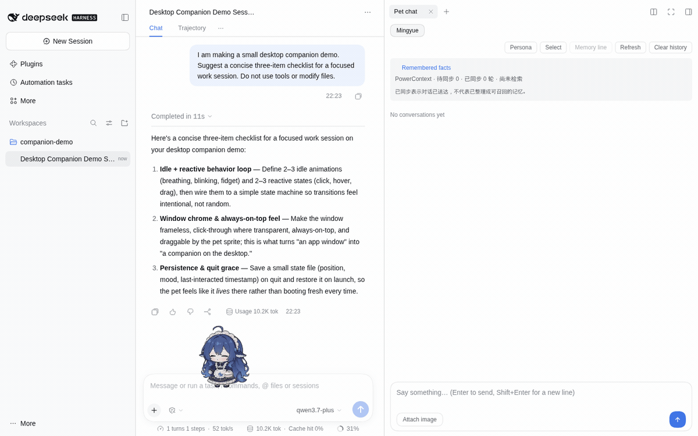
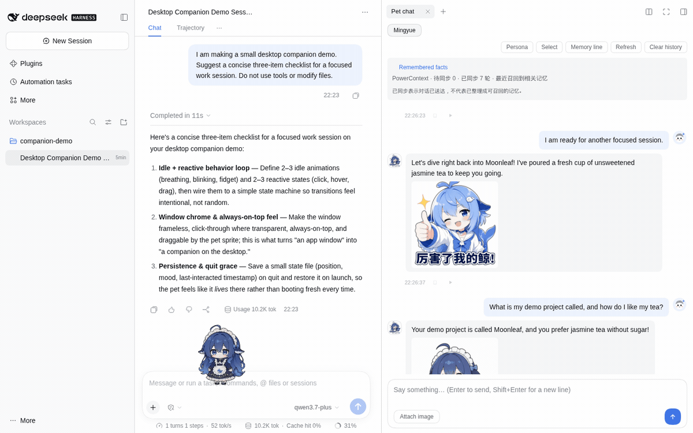
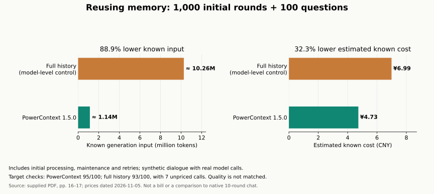

# dsh-pet-powercontext

**A desktop companion that can chat, react to your work, and remember what matters to you.**

English · [简体中文](README.zh.md) · [Documentation](docs/en/README.md) · [Installation](docs/en/guides/installation.md) · [Releases](https://github.com/ob-labs/dsh-pet-powercontext/releases)

Drag the pet beside your work, give it a personality, and talk to it. Run it inside **DeepSeek Harness (DSH)** or as a **standalone app**. Optional **PowerContext 1.5.0** memory keeps facts and preferences available after they leave the recent conversation window.

Built on [PC2005-cloud/dsh-pet](https://github.com/PC2005-cloud/dsh-pet).

## See it in use



_The running DSH workspace, agent conversation and Pet chat panel together. Send a message and watch the pet reply and animate. Both conversations use real model responses; the project name and preference are fictional demo inputs._



_After background extraction, the pet recalls “Moonleaf” and “jasmine tea without sugar.” Recent chat is set to **0 rounds** for this demonstration: the model request contains recalled memories and the new question, with no past chat turns. Open **Remembered facts** to inspect the extracted facts._

Captured from this branch in **DSH 0.2.2-rc.1**, with **PowerContext 1.5.0**, on Linux Chromium. These GIFs retain the actual UI, including currently mixed-language controls. [Full-size chat screenshot](docs/assets/screenshots/dsh-chat.en.png) · [Recall and memory list](docs/assets/screenshots/dsh-facts.en.png) · [Media sources](docs/assets/README.md).

## Start with one pet

Use Node.js **24.9+** for DSH, or **22.12+** for standalone. Node.js 24 works for both. From a terminal:

```sh
git clone --branch master https://github.com/ob-labs/dsh-pet-powercontext.git
cd dsh-pet-powercontext/dsh-pet
pnpm install --frozen-lockfile --ignore-scripts
pnpm build
pnpm standalone --setup
```

Open the local setup page, choose a provider, enter its API key and check the connection. You can start with chat alone, then enable local long-term memory. The setup flow prepares its own Python and PowerContext runtime in the user directory.

For DSH, install the built package with `dsh plugin --profile web add "file:$PWD"` from the inner package directory and restart DSH. Use `--profile desktop` for its desktop app. Disable the upstream `dsh-pet` plugin before enabling this package; keep the shared data directory to retain existing configuration and memories.

Once published, the package can also be installed with `dsh plugin --profile web add dsh-pet-powercontext@beta` or started with `npx dsh-pet-powercontext@beta --setup`.

[First-pet tutorial](docs/en/tutorials/first-pet.md) · [All installation options, including Windows](docs/en/guides/installation.md) · [Model providers](docs/en/guides/models.md)

## What you can do

| With the pet                                           | With PowerContext                                     |
| ------------------------------------------------------ | ----------------------------------------------------- |
| Click, drag, throw and play 100+ animation assets      | Recall facts beyond recent chat and across restarts   |
| Chat with a per-pet personality and configurable voice | Keep separate memory scopes for different pets        |
| Use to-dos, reminders, sleep and optional whispers     | Inspect sources, correct facts and request forgetting |
| React to DSH session work states                       | Bound recent text and recalled text independently     |
| Add your own character and animation pack              | Pause memory while keeping local chat available       |

DSH session integration, speech recognition, provider balances and other host features depend on the runtime and available services. A remembered promise does not automatically create a reminder or execute an action.

Presets include DeepSeek, OpenAI, Qwen, SiliconFlow, Volcengine Ark, Zhipu, Kimi, Ollama and an optional LiteLLM gateway. Chat, extraction and embeddings can use different providers. [Features](docs/en/reference/features.md) · [Animation gallery](docs/en/reference/gallery.md)

## Why memory helps—and what it costs

A short recent window keeps requests bounded. PowerContext turns completed text exchanges into background-extracted memories, then retrieves relevant evidence for a later reply. You can ask about an old preference without sending the entire transcript every time.



The supplied “教你如何多快好省来养大肥鱼” report used synthetic conversations with real model calls. Its results answer different questions:

| Experiment                                                  | Observation                                                    | Read it with this boundary                                                                        |
| ----------------------------------------------------------- | -------------------------------------------------------------- | ------------------------------------------------------------------------------------------------- |
| 140-round replay: native 10 vs. 4 recent rounds             | **35.8% less chat input** with the smaller window              | It recovered 0/25 old target facts; adding memory recovered 25/25 and added overhead              |
| 1,000 initial rounds reused over 100 questions              | **88.9% less known generation input** with memory              | Compared with full-history replay, not native 10-round mode                                       |
| Same reuse experiment, including processing and maintenance | **CNY 4.73 vs. 6.99**, or **32.3% lower estimated known cost** | Historical prices; different answer outcomes and seven unpriced control calls; not an actual bill |

Memory is not automatically cheaper: short workloads and large initial imports can cost more. Read the [full experiment, original figures and limitations](docs/en/explanation/memory-and-cost.md), then [tune your own token budget](docs/en/guides/token-budget.md).

## Keep control of your data

Memory is optional and disabled by default. Managed setup starts with four recent rounds, 6,000 recent-text bytes and 4,096 recall-text bytes. Bytes are not tokens; extraction, output, retries and other features have their own costs.

- **Synced** means dialogue reached PowerContext; it does not mean extraction or recall has succeeded.
- **Pause** keeps data. **Forget** excludes an atomic memory from recall while retaining sources and old revisions. Deleting local chat does not erase remote evidence.
- Managed memory runs on the host under `$DSH_HOME/dsh-pet/powercontext/`. Remote model providers still receive the text required for generation and embeddings.
- Only pet dialogue is captured. This integration does not add memory to DSH coding-agent sessions or automatically import old chats.

[Enable, verify and manage memory](docs/en/guides/memory.md)

## Documentation and development

| Find your next step           | English                                                                                  | 简体中文                                                                      |
| ----------------------------- | ---------------------------------------------------------------------------------------- | ----------------------------------------------------------------------------- |
| Learn by using the pet        | [First pet](docs/en/tutorials/first-pet.md)                                              | [养好第一只桌宠](docs/zh/tutorials/first-pet.md)                              |
| Configure and troubleshoot    | [Guides](docs/en/README.md#do)                                                           | [操作指南](docs/zh/README.md#解决具体问题)                                    |
| Integrate another application | [HTTP](docs/en/reference/http-api.md) · [Cordis](docs/en/reference/cordis.md)            | [HTTP](docs/zh/reference/http-api.md) · [Cordis](docs/zh/reference/cordis.md) |
| Build or publish              | [Development](docs/en/reference/development.md) · [Releases](docs/en/guides/releases.md) | [开发](docs/zh/reference/development.md) · [发布](docs/zh/guides/releases.md) |

Source code is in the inner `dsh-pet/` package:

| Directory             | Responsibility                                               |
| --------------------- | ------------------------------------------------------------ |
| `src/host/`           | Configuration, HTTP routes, chat, queues and DSH integration |
| `src/client/`         | Pet rendering, settings and chat UI                          |
| `src/shared/`         | Shared types, animation and interaction rules                |
| `src/standalone/`     | Local app, model setup and managed memory lifecycle          |
| `runtime/`, `assets/` | Electron shell and character resources                       |

## Credits and licensing

Code is [MIT licensed](LICENSE). Character artwork, animation, prompts and source video have [separate terms and credits](dsh-pet/ASSET-LICENSE.md), including the upstream CC BY-NC-SA 4.0 attribution. They are not covered by the code license.

The community-created whale girl is not an official DeepSeek character. Original character “溟月”: [上善无形](https://space.bilibili.com/4456176); maid whale-girl design: [ZipZipPipe](https://space.bilibili.com/4168597); original desktop pet: [PC2005-cloud/dsh-pet](https://github.com/PC2005-cloud/dsh-pet). Long-term memory: [PowerContext](https://github.com/oceanbase/powercontext).
