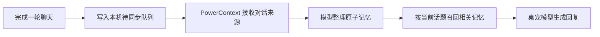

# dsh-pet

**一只会陪你聊天、跟着工作状态动起来，也能记住你偏好的桌宠。**

[English](README.md) · 简体中文

<p>
  
  
  
</p>

dsh-pet 可以住在 **DeepSeek Harness（DSH）** 里，也可以作为**独立应用**运行。你可以拖着它到处跑，给它起名字、设人设，和它聊天，让它念出回复、提醒待办。开启可选的 **PowerContext 1.5.0 长期记忆**后，聊过的偏好和事实可以在后续对话中再次用上，不必一直塞在最近几轮聊天里。

本仓库基于 [PC2005-cloud/dsh-pet](https://github.com/PC2005-cloud/dsh-pet) 扩展。要体验这里介绍的 PowerContext 能力，请构建当前分支；上游 npm 包和下载版不一定包含这些改动。

## 桌宠能做什么

| 能力 | 用起来是什么样 |
| --- | --- |
| 动画与互动 | 100+ 段动画，点击、拖拽、甩抛；多只宠物可以一起漫游、碰撞。 |
| 聊天与人设 | 每只宠物有自己的名字和性格；聊天回复可以配合动作或已有图片。 |
| 语音 | 可选音色并朗读回复；语音输入需要宿主提供兼容服务。 |
| 日常小工具 | 待办清单、到期提醒、睡觉，以及受支持服务商的余额或额度查询。 |
| DSH 联动 | 跟随会话工作状态切换表现，接收任务通知；这些能力依赖 DSH 宿主服务。 |
| 自定义宠物 | 安装独立素材包，也可以自己制作角色和动画。 |
| 长期记忆 | 在不同对话和重启后召回偏好、事实；每只宠物的记忆分别保存。 |

聊天需要配置模型。语音、图片、余额、系统通知和会话联动能否使用，取决于模型、服务商和运行方式。记住“午休时不要打扰我”可以帮助桌宠回答问题，**不会自动修改提醒设置或安排任务**。

更多展示见[动画预览](GALLERY.md)，详细能力见 [FEATURES.md](FEATURES.md)，制作自己的宠物见 [MAKE-YOUR-OWN-PET.md](MAKE-YOUR-OWN-PET.md)。

## 从源码开始使用

准备 **Node.js 22.12 或更高版本**及 pnpm，在仓库根目录执行：

```sh
cd dsh-pet
pnpm install --frozen-lockfile
pnpm build
pnpm standalone --setup
```

打开终端打印的本机设置地址。在「**开始养鱼**」里选择服务商、填写 API Key，检查连接后即可聊天。长期记忆可以暂不开启；需要时再填写 Embedding 模型及其向量维度。

勾选本机长期记忆后，程序会在用户数据目录准备独立的 Python 3.12 和 PowerContext 1.5.0，检查模型连接和记忆服务的就绪状态。首次安装需要联网，以及系统 `curl`、`tar` 工具。自动安装支持 Linux/macOS；Windows 随 PowerContext 保持实验性支持。

需要桌面窗口时，构建后先运行 `pnpm ensure:electron`，再运行 `pnpm start:app`。桌面渲染需要图形会话和 Electron，项目脚本会准备对应运行时；没有桌面的 Linux 环境可以使用本机网页。

### 在 DSH 中使用

完成上述构建后，在内层 `dsh-pet/` 包目录执行：

```sh
# 浏览器版 DSH
dsh plugin --profile web add "file:$PWD"
# DSH 桌面应用把 web 改成 desktop
```

安装或修改宿主代码后重启 DSH。此集成支持 DSH `0.2.2-rc.1`，该版本 CLI 需要 **Node.js 24.9 或更高版本**。

打开 **设置 → 桌宠配置 → 本机长期记忆**，选择记忆模型预设，或填写生成模型与 Embedding 配置，点击「检查并启用记忆」。页面显示安装进度和服务就绪状态，并提供取消、暂停、恢复和重试。聊天继续使用 DSH 中选择的模型，记忆整理单独配置模型。

本机服务安装在运行 DSH 的机器上，应用于默认宠物条目；自定义宠物包保留独立设置。已有 PowerContext 服务也可在宠物的模型设置中连接。当前只采集桌宠对话，尚未给 DSH 的编程 Agent 会话接入记忆。

分发安装包时，在内层包目录运行 `npm pack --pack-destination /仓库外的目录`，再用 `dsh plugin --profile web add /绝对路径/dsh-pet-0.4.7.tgz` 安装。反复验证重新构建的包时，为每个归档使用不同文件名，避免安装器命中本地归档缓存。

上游包安装、Windows 下载版和打包方法见 [INSTALL.md](INSTALL.md)。

## PowerContext 带来了什么

最近几轮对话足以接住当下的话题，却很容易丢掉更早聊过的细节。PowerContext 把适合长期保留的事实和偏好整理出来，在相关话题出现时再取回，避免每次都重放整段聊天记录。

比如你告诉它：“我喜欢喝无糖茉莉花茶。”后台整理完成后，即使这句话已经不在近期窗口里，之后聊到饮料时仍有机会召回。追问“那我呢？”时，检索会参考最近对话来理解指代。口味变了，可以直接查看并更正那条记忆。



- **近期上下文与长期记忆分开控制。** 聊天中的分界线按实际字节预算计算近期轮数，不表示线外的内容都被遗忘了。
- **每只宠物独立记忆。** 绑定和待同步记录会持久保存，重启后继续使用；切换服务地址不会把旧队列发送到新服务。
- **记住了什么，可以看见。** 在聊天里打开「记得的事」，浏览当前可召回的记忆，查看来源摘录、更正内容或确认遗忘。更正带版本校验，避免旧页面覆盖新内容。
- **记忆暂时不可用，仍能聊天。** 召回超时后使用近期对话继续；采集失败的问答留在本机队列里重试。
- **历史证据不等于当前指令。** 召回内容按历史资料交给模型，当前用户的纠正优先。

长期记忆默认关闭。首次使用本机引导接入时，默认保留 4 轮近期历史、最多 6000 字节近期正文及 4096 字节召回正文。前台召回默认超时 1.5 秒，后台生成另设 120 秒超时。这些是上限，不是响应速度承诺。

### 怎样确认它真的记住了

1. 开启记忆，等待服务就绪。
2. 告诉桌宠一个明确、适合长期保存的偏好，完成一轮问答。
3. 查看待同步、已同步状态，等待后台整理后，在「记得的事」中刷新。
4. 在后续聊天里重新谈到相关话题。回答不对时，先核对记忆正文与来源，再决定更正或遗忘。

**“已同步”只表示对话送达，不表示已经抽取，也不保证一定召回。** 后台每 30 秒检查一次；实际整理可能更久，也可能判断这轮对话没有值得长期记住的内容。

已有服务器的接入、鉴权和故障恢复见 [POWERCONTEXT.md](POWERCONTEXT.md)。

## 数据放在哪里，怎样控制

| 操作 | 实际效果 |
| --- | --- |
| 删除聊天记录 | 删除本机消息，取消对应的未发送记录；已送达或正在发送的对话、远端记忆仍保留。 |
| 更正一条记忆 | 保存新的内容版本，原始来源仍作为历史证据保留。 |
| 遗忘一条记忆 | 将该原子记忆标记为 forgotten，停止长期召回；不物理删除来源和旧版本。近期聊天或新对话仍可能包含同一信息。 |
| 暂停记忆 | 停止新的召回和补传；本机管理模式还会停止对应记忆进程。已有数据保留。 |

希望某件事既不进入近期上下文、也不再长期召回时，需要**遗忘对应记忆，并删除相关本机聊天**。这不等于物理清除全部远端证据；有彻底删除要求时，还需另行管理服务端数据与保留策略。删除宠物前，先管理它的长期记忆，以免失去界面入口和绑定线索。

本机聊天保存在宠物数据目录的 `memory.json` 中。本机管理的 PowerContext 把数据库、运行时和私有设置放在 `$DSH_HOME/dsh-pet/powercontext/`，只监听回环地址，使用自动生成的令牌。生成和 Embedding 仍会把所需文本发送给你配置的模型服务商，也可能产生费用；数据库在本机，不代表模型推理也在本机。

## 开发与接口

代码在内层 `dsh-pet/` 目录：

- `src/host/`：配置、聊天、记忆持久化、路由和 DSH 集成。
- `src/client/`：桌宠渲染、聊天和设置界面。
- `src/shared/`：共享类型、动画和互动逻辑。
- `src/standalone/`：独立运行、模型配置、本机记忆生命周期。
- `runtime/`：Electron 桌面壳；`assets/`：动画与其他素材。

```sh
pnpm typecheck
pnpm lint
pnpm format:check
pnpm check:cycles
pnpm check:runtime
pnpm check:openapi
pnpm test
pnpm test:ui
pnpm build
```

配置参考 [CONFIG.md](CONFIG.md)。HTTP 能力见 [API.md](API.md) 和 [openapi.yaml](openapi.yaml)，插件调用见 [CORDIS-API.md](CORDIS-API.md)、[CORDIS.md](CORDIS.md)。反馈问题时请附提交或版本、操作系统、运行方式及复现步骤；分享日志前去掉密钥和私人聊天内容。

## 致谢与许可

代码采用 [MIT](LICENSE)。宠物形象、动画、提示词和源视频另受角色相关授权约束，不能把代码的 MIT 许可套用到素材上。

角色是社区二创的 DeepSeek「大肥鱼／鲸鱼娘」，**不是 DeepSeek 官方形象**。原型「溟月」出自 [上善无形](https://space.bilibili.com/4456176)，女仆鲸鱼娘设计出自 [ZipZipPipe](https://space.bilibili.com/4168597)。上游注明的形象授权为 [CC BY-NC-SA 4.0](https://creativecommons.org/licenses/by-nc-sa/4.0/deed.zh-hans)：署名、非商业、相同方式共享，详见[原始声明](https://www.bilibili.com/opus/1247156596114456581)。衍生作品须在公开仓库或产品网站注明 [PC2005-cloud/dsh-pet](https://github.com/PC2005-cloud/dsh-pet)。

长期记忆由 [PowerContext](https://github.com/oceanbase/powercontext) 提供。
