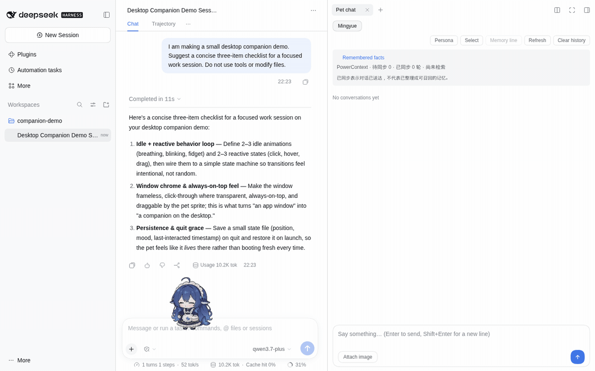
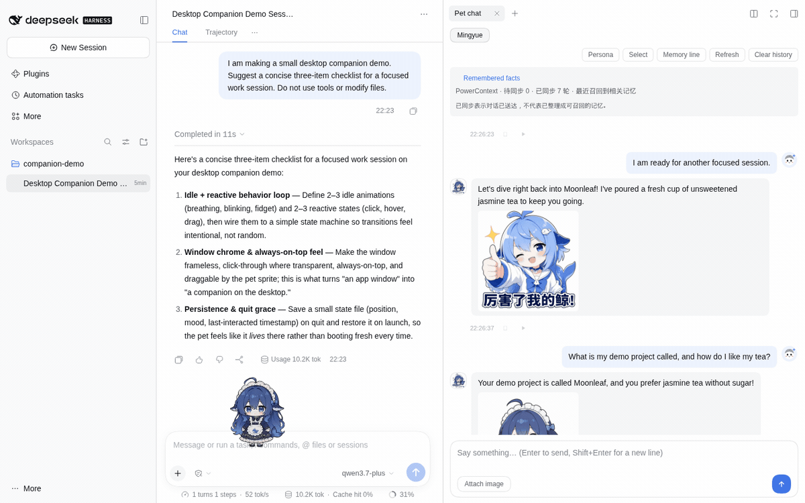
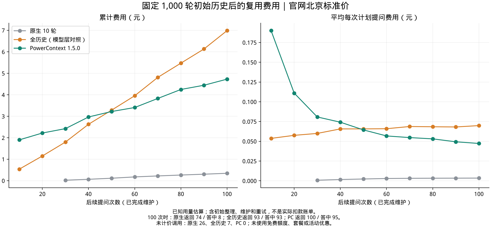

# dsh-pet-powercontext

**一只会陪你聊天、跟着工作状态动起来，也能记住你偏好的桌宠。**

[English](README.md) · 简体中文 · [文档](docs/zh/README.md) · [安装](docs/zh/guides/installation.md) · [下载版本](https://github.com/ob-labs/dsh-pet-powercontext/releases)

把她拖到工作区旁边，写一段人设，随时聊两句。桌宠既能作为 **DeepSeek Harness（DSH）插件**，也能 **独立运行**。可选的 **PowerContext 1.5.0** 长期记忆，让事实与偏好在退出近期聊天窗口后仍有机会被找回。

本项目基于 [PC2005-cloud/dsh-pet](https://github.com/PC2005-cloud/dsh-pet)。

## 看看用起来的样子



_同一界面保留 DSH 工作区、Agent 会话和桌宠聊天面板，实际发送消息，观看桌宠回复和动作。两边的回复都来自真实模型调用；项目名和饮品偏好是虚构的演示输入。_



_后台抽取后，桌宠再次答出项目名 Moonleaf 和“无糖茉莉花茶”。本次演示将近期聊天设为 **0 轮**：实际模型请求携带召回记忆和新问题，没有携带历史问答。展开「Remembered facts」可以查看抽取后的事实。_

以上 GIF 在 Linux Chromium 中实录，使用当前分支、**DSH 0.2.2-rc.1** 与 **PowerContext 1.5.0**，保留界面原有的中英文控件。[查看原尺寸聊天截图](docs/assets/screenshots/dsh-chat.en.png) · [召回与记忆列表](docs/assets/screenshots/dsh-facts.en.png) · [图文来源](docs/assets/README.md)。

## 先养好一只

[npm 包](https://www.npmjs.com/package/dsh-pet-powercontext)已发布到 **beta** 通道，当前版本为 `0.1.0-beta.1`。下面任选一种方式，无需下载源码或编译。

### 已经在用 DSH

已安装 DSH 和 **Node.js 24.9+** 时，在终端执行：

```sh
dsh plugin --profile web add dsh-pet-powercontext@beta
```

DSH 桌面版把 `--profile web` 换成 `--profile desktop`。重启 DSH，打开「设置 → 桌宠配置」，通过「Pet chat（桌宠对话）」聊天，沿用 DSH 模型。如果已启用上游 `dsh-pet` 插件，先将其停用，保留数据目录。

### Windows：下载后双击

1. [下载 Windows x64 ZIP](https://github.com/ob-labs/dsh-pet-powercontext/releases/download/v0.1.0-beta.1/dsh-pet-win-x64.zip)。
2. 完整解压，双击 **dsh-pet.exe**，无需安装 Node.js。
3. 在桌宠菜单选择「打开 AI 设置」，选择服务商、填写 API Key 并检查连接。

### 独立模式：一条命令启动

已安装 **Node.js 22.12+** 时，执行：

```sh
npx --yes dsh-pet-powercontext@beta --setup
```

在自动打开的设置页中选择模型服务商并检查连接，使用期间保持终端运行。可以先聊天，长期记忆按需开启。

[小白上手教程](docs/zh/tutorials/first-pet.md) · [安装详情与更新](docs/zh/guides/installation.md) · [选择模型服务](docs/zh/guides/models.md)

## 桌宠与记忆分别做什么

| 桌宠提供                             | PowerContext 提供                  |
| ------------------------------------ | ---------------------------------- |
| 点击、拖拽、抛掷，播放 100+ 动画素材 | 跨越近期窗口和重启，按问题召回事实 |
| 独立人设、聊天与可配置语音           | 不同宠物各自的记忆 Scope           |
| 待办、提醒、睡觉和可选碎碎念         | 查看来源、更正事实、申请遗忘       |
| 跟随 DSH 会话工作状态                | 分别限制近期正文与召回正文         |
| 安装自己的角色和动画包               | 暂停记忆后继续使用近期聊天         |

会话联动、语音识别、服务商余额等能力取决于运行方式和宿主服务。聊天中记住一句承诺，不会自动创建提醒或执行动作。

模型预设包括 DeepSeek、OpenAI、通义千问、硅基流动、火山方舟、智谱、Kimi、Ollama 和可选 LiteLLM 网关。聊天、记忆整理与 Embedding 可以使用不同服务商。[功能说明](docs/zh/reference/features.md) · [动画预览](docs/zh/reference/gallery.md)

## 为什么接记忆，token 又省在哪里

小窗口控制当轮输入。PowerContext 将成功的文本问答交给后台整理，再按新问题召回相关证据，让应用不必每次把完整聊天都带给模型，也能接上较早的经历。



所提供的《教你如何多快好省来养大肥鱼》使用合成对话和真实模型调用，几个结果回答的是不同问题：

| 实验                                  | 观察结果                                  | 适用条件                                                         |
| ------------------------------------- | ----------------------------------------- | ---------------------------------------------------------------- |
| 140 回合回放：原生近期 10 轮改为 4 轮 | 聊天输入减少 **35.8%**                    | 小窗口答中旧事实 0/25；加入记忆达到 25/25，也增加了开销          |
| 固定 1000 轮初始历史，复用 100 次     | 已知生成输入减少 **88.9%**                | 对照是每次携带全历史，不是默认原生 10 轮                         |
| 同一复用实验，计入整理与维护          | 已知费用估算 **¥4.73 对 ¥6.99，低 32.3%** | 历史价格估算；回答结果不同，对照还有七次未计价调用，不是实际账单 |

长期记忆不会自动更便宜，短对话和大批历史的初次导入可能更贵。请连同[完整实验、原图与限制](docs/zh/explanation/memory-and-cost.md)一起看，再按[用量控制指南](docs/zh/guides/token-budget.md)调整自己的桌宠。

## 数据与控制权

记忆默认关闭，按需开启。本机记忆首次设置采用近期 4 轮、近期正文 6000 字节和召回正文 4096 字节。字节不是 token，后台抽取、输出、重试和其他功能还有各自的费用。

- **已同步**只表示对话送达 PowerContext，不代表抽取完成或一定能召回。
- **暂停**保留数据；**遗忘**将原子记忆移出召回，来源和历史版本仍保留。删除本机聊天不会删除远端证据。
- 本机记忆在宿主的 `$DSH_HOME/dsh-pet/powercontext/` 下运行，远程模型仍会收到生成和 Embedding 所需文本。
- 只采集桌宠对话，尚未给 DSH 编程 Agent 会话接入记忆，也不会自动导入旧聊天。

[启用、验证与管理记忆](docs/zh/guides/memory.md)

## 文档与开发

| 下一步       | English                                                                                  | 简体中文                                                                      |
| ------------ | ---------------------------------------------------------------------------------------- | ----------------------------------------------------------------------------- |
| 跟着教程使用 | [First pet](docs/en/tutorials/first-pet.md)                                              | [养好第一只桌宠](docs/zh/tutorials/first-pet.md)                              |
| 配置与排障   | [Guides](docs/en/README.md#do)                                                           | [操作指南](docs/zh/README.md#解决具体问题)                                    |
| 接入其他应用 | [HTTP](docs/en/reference/http-api.md) · [Cordis](docs/en/reference/cordis.md)            | [HTTP](docs/zh/reference/http-api.md) · [Cordis](docs/zh/reference/cordis.md) |
| 开发与发布   | [Development](docs/en/reference/development.md) · [Releases](docs/en/guides/releases.md) | [开发](docs/zh/reference/development.md) · [发布](docs/zh/guides/releases.md) |

源码位于内层 `dsh-pet/` 包目录：

| 目录                  | 职责                                   |
| --------------------- | -------------------------------------- |
| `src/host/`           | 配置、HTTP 路由、聊天、队列与 DSH 接入 |
| `src/client/`         | 角色渲染、设置和聊天界面               |
| `src/shared/`         | 共享类型、动画与交互规则               |
| `src/standalone/`     | 独立应用、模型设置与本机记忆生命周期   |
| `runtime/`、`assets/` | Electron 外壳与角色素材                |

## 致谢与许可

代码采用 [MIT 许可](LICENSE)。角色形象、动画、提示词与源视频遵循[单独的许可和署名要求](dsh-pet/ASSET-LICENSE.md)，包括上游注明的 CC BY-NC-SA 4.0，不适用代码许可。

鲸鱼娘是社区二创形象，并非 DeepSeek 官方角色。原型“溟月”：[上善无形](https://space.bilibili.com/4456176)；女仆鲸鱼娘设计：[ZipZipPipe](https://space.bilibili.com/4168597)；原版桌宠：[PC2005-cloud/dsh-pet](https://github.com/PC2005-cloud/dsh-pet)；长期记忆：[PowerContext](https://github.com/oceanbase/powercontext)。
