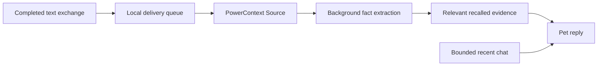
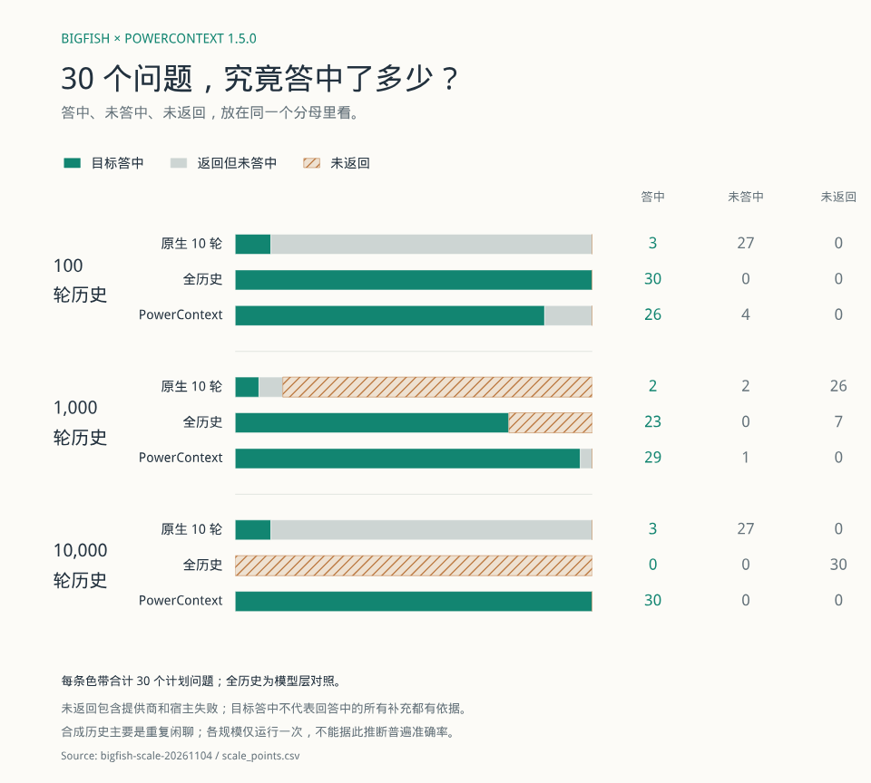
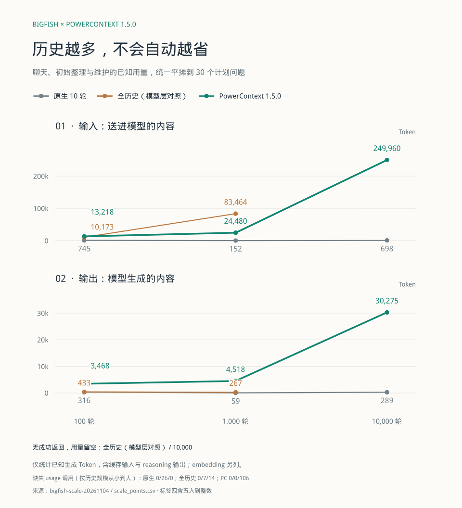
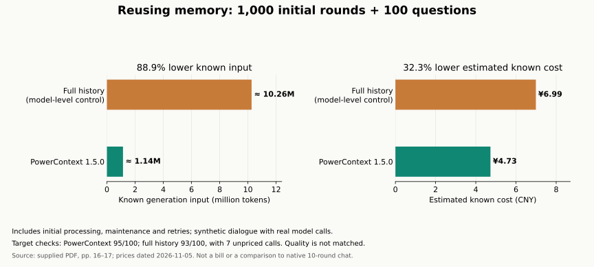
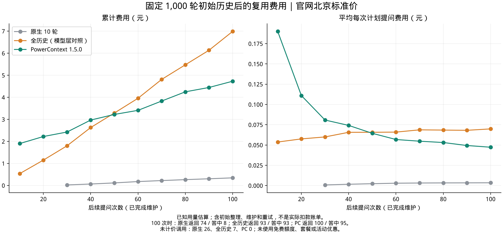

# Memory, token usage and cost

English · [简体中文](../../zh/explanation/memory-and-cost.md) · [Documentation](../README.md)

**A smaller recent window can reduce chat input. Long-term memory can recover old facts, but extraction and maintenance also cost tokens.** The relevant question is what useful memory you retain for the total cost of your workload.

## How the pet uses memory

Local chat storage, recent prompt context and long-term memories are separate. The default native pet reads the last 10 rounds; a larger local archive does not automatically increase each request. Managed memory starts with a four-round/6,000-byte recent-text budget and a separate 4,096-byte recall budget. Neither byte limit is a total token limit.

## Where these results come from

The figures and values below come from the supplied report **“教你如何多快好省来养大肥鱼”**, pages 13–17. It describes real standalone pet and PowerContext 1.5.0 calls with `qwen3.7-plus`, using synthetic conversations. This documentation transcribes that report; it does not claim a new benchmark run. Full raw logs and per-call accounting are not included in this repository.

“Full history” is a model-level experimental control that sends the accumulated transcript. It is different from the shipped native 10-round mode. “Known usage” excludes calls without usage reports; missing usage is never treated as zero. Target-fact checks are limited checks, not an assessment of every sentence in an answer.

## Experiment 1: recent context and old facts

Each configuration replayed 140 rounds organized as seven logical days, not seven days of continuous use. Five fact categories were checked five times each after leaving the recent window.

| Configuration                     | Chat input tokens | Known facts outside the window | Correctly admits an unknown fact |
| --------------------------------- | ----------------: | -----------------------------: | -------------------------------: |
| Native, 10 recent rounds          |            78,396 |                           2/25 |                              5/5 |
| Native, 4 rounds / 6,000 bytes    |            50,314 |                           0/25 |                              5/5 |
| Same recent budget + PowerContext |            87,339 |                          25/25 |                              5/5 |

The smaller native window reduced chat input by **35.8%**. Adding memory recovered the checked facts but used more chat input than either native group.

Total generation usage tells another part of the story: native 10-round input plus output was 183,476 tokens. Memory with background encoding disabled had 648,085 known chat-plus-memory generation tokens, plus embeddings and one call with missing usage. A separate encoding-enabled configuration also passed the 25 fact and five unknown checks and reduced known background input; this is a background-processing optimization, not automatic compression of every pet chat request.

## Experiment 2: larger imported histories

The report imported 100, 1,000 and 10,000 synthetic rounds and asked 30 planned questions per configuration. Each history round contains both sides of a conversation.

_Original figure in Chinese, PDF p. 15. Green = target hit; gray = returned without a target hit; hatched orange = no response._

| Imported rounds | Native hits / returned / planned | Full-history hits / returned / planned | PowerContext hits / returned / planned |
| --------------: | -------------------------------: | -------------------------------------: | -------------------------------------: |
|             100 |                      3 / 30 / 30 |                           30 / 30 / 30 |                           26 / 30 / 30 |
|           1,000 |                       2 / 4 / 30 |                           23 / 23 / 30 |                           29 / 30 / 30 |
|          10,000 |                      3 / 30 / 30 |                             0 / 0 / 30 |                           30 / 30 / 30 |

_Original figure in Chinese, PDF p. 16. Known generation usage includes initial processing and maintenance, divided by 30 planned questions. Embeddings are separate. Points are rounded._

| History rounds | Native input / output | Full-history input / output | PowerContext input / output |
| -------------: | --------------------: | --------------------------: | --------------------------: |
|            100 |             745 / 316 |                10,173 / 433 |              13,218 / 3,468 |
|          1,000 |              152 / 59 |                83,464 / 267 |              24,480 / 4,518 |
|         10,000 |             698 / 289 |                 Unavailable |            249,960 / 30,275 |

The low native usage at 1,000 rounds coincided with 26 failed requests; it is not an efficiency win. The full-history control hit the service's input limit at 10,000 rounds and returned no answers. The figure reports missing-usage call counts of 0/26/0 for native, 0/7/14 for full history, and 0/0/106 for PowerContext as history size increases. These totals are incomplete accounting, not zero-cost failures.

This experiment did **not** establish that a larger history automatically saves money: memory ingestion and maintenance increased with the imported volume.

## Experiment 3: reuse a fixed memory store

With the initial history fixed at 1,000 rounds, the report asked 100 subsequent questions and waited for maintenance after each ten. Initial processing, maintenance and retries were counted.

| Measure after 100 planned questions |                      PowerContext |               Full-history control |
| ----------------------------------- | --------------------------------: | ---------------------------------: |
| Known generation input              | Approximately 1.14 million tokens | Approximately 10.26 million tokens |
| Estimated known cost                |                          CNY 4.73 |                           CNY 6.99 |
| Returned answers                    |                           100/100 |                             93/100 |
| Target checks passed                |                            95/100 |                             93/100 |
| Unpriced calls                      |                                 0 |                                  7 |

Known input was **88.9% lower**; estimated known cost was **32.3% lower** (CNY 2.26). The first recorded checkpoint below full-history cost was question 50; checkpoints were ten questions apart, so this is not an exact continuous break-even estimate. Memory startup/initial processing cost about CNY 1.52 and maintenance about CNY 2.70.

_Original figure in Chinese, PDF p. 17. Green = PowerContext; orange = full history; gray = native 10-round mode. The English summary redraws only the stated 100-question totals and does not reconstruct intermediate points._

The native group in this experiment returned 74/100 answers and passed eight target checks, with 26 unpriced calls. The full-history group returned 93 and passed all 93 returned checks; seven calls were unpriced. The groups did not answer exactly the same set of questions. The synthetic history contained few core facts and repetitive small talk. **This is not a claim of equal quality or a saving relative to native mode.**

## How the cost estimate was calculated

The report applies Beijing standard pay-as-you-go prices dated **2026-11-05**, without promotional discounts. It uses CNY 2 / 0.4 / 8 per million ordinary input / cached input / output tokens for `qwen3.7-plus` requests up to 256,000 input tokens, and CNY 0.5 per million embedding tokens for `qwen3.7-text-embedding`.

These are the report's historical pricing assumptions, not current price guidance or an actual invoice. Calls went through a gateway; the upstream region and discounts could not be confirmed. Full history had an 84.1% input cache hit rate, while PowerContext generated about ten times as many output tokens. Those differences explain why input-token reduction and estimated cost reduction are different numbers.

## What to do with these observations

Start with bounded recent context. Add memory when retaining facts matters, then measure the entire workload, including background work, output, caching, failures and answer quality. Use [the token-budget guide](../guides/token-budget.md) and [the out-of-window check](../tutorials/first-pet.md#check-memory-outside-the-recent-window) before drawing conclusions about your own use.
