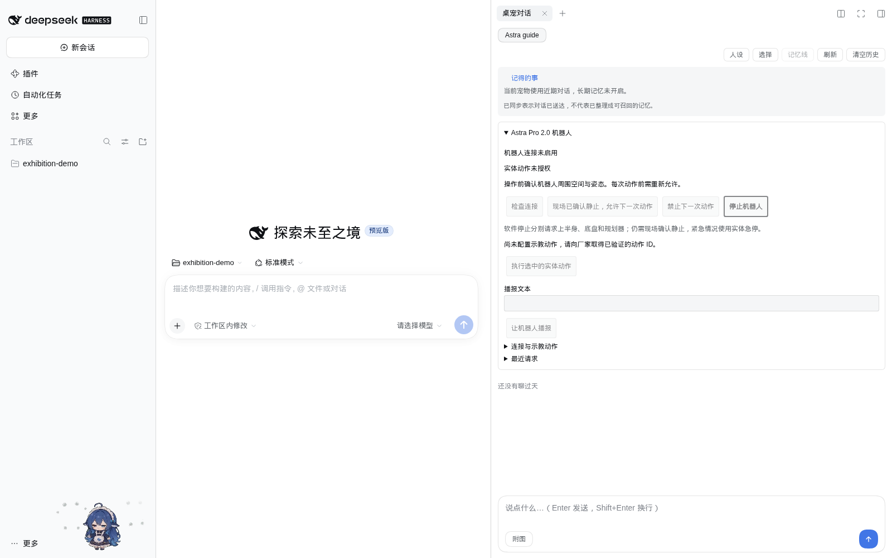
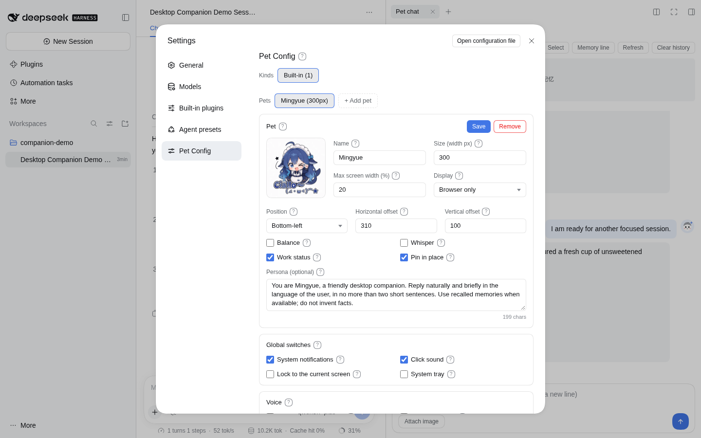
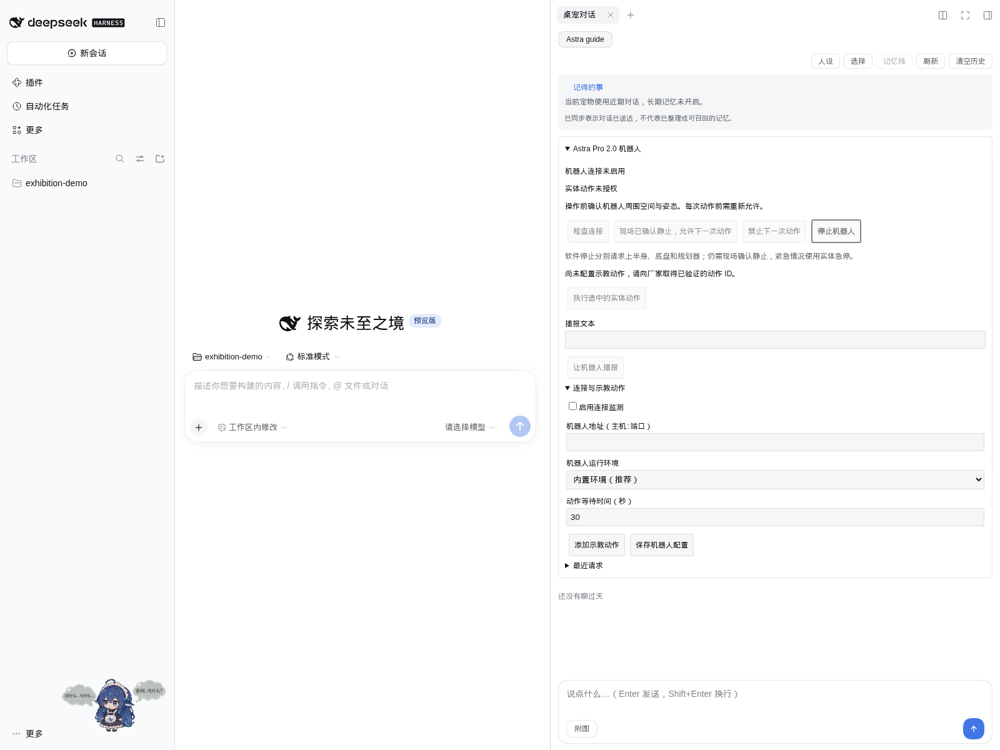

# From installing the pet to interacting with Astra Pro 2.0

English · [简体中文](../../zh/tutorials/astra-first-interaction.md) · [Documentation home](../README.md)

This tutorial takes you through installing dsh-pet, configuring chat, connecting Astra Pro 2.0, and using the pet panel to request speech and manufacturer-verified robot actions.

**Required build:** a `slim` preview containing robot support. The build checked on 2026-11-13 comes from commit `faa9197` and passed native validation on all five platforms. The published npm `0.1.0-beta.1` and older Windows ZIP do not include robot support. Preview filenames also contain `0.1.0-beta.1`: identify them by the **`slim` suffix and build source**, not the version alone.

## 1. Prepare your equipment and connection details

| Item                     | What you need                                                                                                                             |
| ------------------------ | ----------------------------------------------------------------------------------------------------------------------------------------- |
| Host computer            | Windows x64, Linux x64 / ARM64, or macOS Intel / Apple Silicon; choose the package for this computer, not the robot's OS                  |
| Astra Pro 2.0            | A device commissioned and checked by the manufacturer, with taught actions already prepared                                               |
| Network                  | The computer running the pet or DSH can reach the robot's gRPC service                                                                    |
| Manufacturer information | Actual address and gRPC port, verified action IDs and ordering, required starting posture and modes, and recovery procedures after a stop |
| Chat model               | Provider, endpoint, model ID and API key if you want pet chat; robot controls do not require a model key                                  |

You can send this request to the manufacturer's technical team:

> Please provide the exhibition Astra Pro 2.0's gRPC address and port, verified taught-action IDs and execution order, each action's starting posture and mode requirements, and recovery procedures after software or physical emergency stops. Please arrange on-site support for the first integration test.

Do not copy addresses, ports or action IDs from demonstration programs. Sharing Wi-Fi does not prove the gRPC port is reachable. If DSH runs on a server or in a container, **that server or container** must reach the robot.

## 2. Download the right package

Open [the verified slim build](https://github.com/ob-labs/dsh-pet-powercontext/actions/runs/43197695059), sign in to GitHub, and download the appropriate item from **Artifacts**. Artifacts expire after seven days. If expired, select a newer successful run of [Robot slim bundles](https://github.com/ob-labs/dsh-pet-powercontext/actions/workflows/robot-bundles.yml) or ask the maintainer to rebuild.

| Host computer                  | Artifact                  |
| ------------------------------ | ------------------------- |
| Windows x64                    | `robot-slim-win32-x64`    |
| Linux x64                      | `robot-slim-linux-x64`    |
| Linux ARM64                    | `robot-slim-linux-arm64`  |
| macOS Intel                    | `robot-slim-darwin-x64`   |
| macOS Apple Silicon (M series) | `robot-slim-darwin-arm64` |

Extract the artifact ZIP downloaded from GitHub first. It contains application packages, a runtime archive and size reports:

- **Standalone Windows desktop pet:** use `dsh-pet-win32-x64-desktop-slim.zip`.
- **DSH plugin or Node standalone:** use `dsh-pet-powercontext-<version>-<platform>-slim.tgz`. Keep the `.tgz` intact for the installation command.
- `astra-runtime-<platform>-slim.tar.gz` is already included in the application packages; there is no separate installation step.
- The ordinary `desktop.zip` in the Windows artifact lacks the bundled robot runtime. Choose `desktop-slim.zip` for this tutorial.

The slim package includes private Python, Astra SDK 2.0.0 and control dependencies. You do not need to install Python, and your existing Python installation is not modified. OpenCV, NumPy and the manufacturer's camera/image helpers are excluded. See [package details](../guides/robot-bundles.md).

## 3. Install the pet: choose one route

### A. Windows desktop: no DSH or Node.js required

1. Fully extract `dsh-pet-win32-x64-desktop-slim.zip` into a writable directory, such as `D:\Apps\dsh-pet-astra`.
2. Open its `win-unpacked` folder and double-click `dsh-pet.exe`.
3. Keep the entire folder, including `resources`. Do not copy just the EXE or launch it from inside an archive viewer.
4. AI settings open on first launch. You can reopen them from the pet's context menu: **打开 AI 设置** (Open AI settings).

**Expected result:** a character appears on the desktop and you can open AI settings. Robot monitoring is disabled by default, so the pet can be used independently. This preview is unsigned and Windows may show a reputation prompt; verify the download source rather than disabling system protection.

### B. Install into an existing DeepSeek Harness

This route requires an installed DSH host. The tutorial uses **DSH 0.2.2-rc.1**, whose CLI requires Node.js **24.9+**. For the DSH desktop application, launch it once to initialize its profile, then fully quit it before installation.

If the upstream `dsh-pet` is enabled, disable it first and preserve the user data directory. The two plugins share routes and configuration.

Run the appropriate command in a terminal, replacing the **archive path** with your actual download path.

Windows PowerShell, DSH web profile:

```powershell
dsh plugin --profile web add "C:\Downloads\dsh-pet-powercontext-0.1.0-beta.1-win32-x64-slim.tgz"
```

Linux x64, DSH web profile:

```bash
dsh plugin --profile web add "$HOME/Downloads/dsh-pet-powercontext-0.1.0-beta.1-linux-x64-slim.tgz"
```

Use the corresponding filename for Linux ARM64 or macOS. For DSH Desktop, replace `--profile web` with `--profile desktop`. These commands let DSH install and enable the local plugin; DSH's own dependencies may still require network access.

Restart DSH using your normal launcher (`dsh web` for a typical web installation), or reopen the desktop application. Open **Settings → Pet settings**. On first use, add and select a workspace, then open the right sidebar and select **Pet chat**; the sidebar entry may be absent until a workspace is selected. Robot controls appear in the full pet chat panel, not the small context-menu chat popup.

**Expected result:** DSH displays the pet, and Pet chat contains **Astra Pro 2.0 robot**. The following screenshot is from a real DSH installation of this slim package, with no robot connected. Its interface is in Chinese.



### C. Node standalone on Linux, macOS or other supported hosts

The slim plugin archive also runs without DSH. Install Node.js **22.12+**, create an empty application directory, then run:

```bash
mkdir astra-pet
cd astra-pet
npm install --offline --legacy-peer-deps "/absolute/path/dsh-pet-powercontext-0.1.0-beta.1-linux-x64-slim.tgz"
npx --no-install dsh-pet-powercontext --setup
```

Replace the path and platform with your archive. `--offline` installs the plugin from the local package; model services, the first Electron download for the desktop character, and optional memory-service installation may still need the internet. The Windows desktop ZIP already contains Electron.

Keep the terminal running during use; press `Ctrl+C` to exit. Next time, enter the same directory and run the final command again. A headless server has no desktop character, but browser settings and chat remain available. Linux packages target glibc, not Alpine/musl.

## 4. Configure the pet and verify chat

### DSH plugin

1. Configure your chat provider and model in DSH, then select an available model using the host's model selector.
2. Open **Settings → Pet settings** to adjust the name, size, position and persona.
3. Open **Pet chat** in the right sidebar, select a pet, and send: “Hello, introduce yourself in one sentence.”

Chat follows the current DSH model by default. Robot connectivity does not use this API key. An exhibition persona could be: “You are an exhibition guide. Keep answers short and clear. Do not claim to have performed a physical action that the operator has not confirmed.” The persona affects replies; physical actions still require the panel controls.



### Windows / Node standalone

The standalone setup page currently uses Chinese labels:

1. Open **AI settings → 开始养鱼** (setup). If chat is already configured, select **沿用当前聊天配置** (reuse current chat configuration).
2. Choose a **聊天服务商** (chat provider): presets include DeepSeek, OpenAI, Qwen, SiliconFlow, Ollama, LiteLLM and custom compatible services.
3. Check **聊天接口地址** (chat endpoint), then enter that service's **聊天 API 密钥** (API key).
4. Click **获取模型列表** (fetch models), select a model available to your account, or enter its ID directly. A listed model is not proof of invocation permission.
5. Leave local memory disabled for the first check. Click **开始养鱼** to validate the connection. After success, click **去聊天** (go to chat), or open the settings page's chat tab.
6. Send a short message and verify a reply. Changing the endpoint requires a key for that endpoint.

No particular provider or fixed model name is required. Ollama needs a separately installed service and downloaded model; choosing LiteLLM does not install a gateway. See [model configuration](../guides/models.md).

### Optional memory and computer speech

PowerContext remembers preferences and information from successful chats. **It is not required for robot control.** Enable it later by configuring a memory-generation model and text embedding model with the correct dimensions. The robot's bundled Python/SDK does not include an installed PowerContext service; memory is prepared separately, and automatic setup on Windows remains experimental. Follow [memory setup](../guides/memory.md).

Pet speech through the computer and speech through the robot are separate. Computer speech is configured in the pet's voice settings. Robot speech uses the **Speak through robot** button described below; chat replies are not forwarded automatically to the robot speaker.

## 5. Connect Astra Pro 2.0

1. Ask the manufacturer to confirm the robot is ready, its 2.0 gRPC service is running, and the host can reach that port.
2. In the full pet chat panel, expand **Astra Pro 2.0 robot → Connection and taught actions**.
3. Fill in the fields below. You can check connectivity before adding any actions.

| Field                             | Value                                                                                                                          |
| --------------------------------- | ------------------------------------------------------------------------------------------------------------------------------ |
| Enable connection monitoring      | Enable it; monitoring does not authorize motion                                                                                |
| Robot address (host:port)         | The actual manufacturer-provided `IP:port` or `hostname:port`; omit `http://`, `https://` and URL paths. IPv6 is not supported |
| Robot runtime                     | **Bundled environment (recommended)**; no system Python path is needed                                                         |
| Action response timeout (seconds) | Default 30; an integer from 3 to 120. This limits waiting for an RPC response, not the physical action duration                |

4. Click **Save robot configuration**. “Configuration saved and control disarmed. Check the connection.” is expected: saving clears motion authorization.
5. Click **Check connection**. A successful check shows **Connected** and the controller's description. It reads state without changing modes or moving the robot.



Monitoring reads state approximately every five seconds. A sample older than 15 seconds is considered stale. **Connected does not mean ready for motion**: actions also require idle controller code `520000` and body, left-arm and right-arm modes all equal to `1`. The manufacturer must verify and set modes with its own tools; the pet panel does not switch to automatic mode.

## 6. First interaction: speech, then one action

### Ask the robot to speak

1. Confirm **Connected** and that no other application request is in progress.
2. Enter “Hello, welcome to our exhibition booth” in **Speech text**. The limit is 500 characters.
3. Click **Speak through robot**.
4. Expand **Recent requests** to read the response, and listen on site to confirm actual audio.

Speech does not require motion authorization, but does require an explicit click. Sending speech also clears any previously granted one-action authorization. A successful response means the speech request was accepted, not that playback has completed.

### Add a manufacturer-verified taught action

1. Expand **Connection and taught actions**, then click **Add taught action**.
2. Set **Action name** to a recognizable label, such as “Booth welcome.” This label does not teach the robot a new movement.
3. Enter the verified numeric ID in **Manufacturer-verified action IDs**. Words such as “wave” are not action IDs.
4. Leave **Pet animation name** blank initially so you can focus on checking the physical action.
5. Click **Save robot configuration**, then **Check connection** again.

For a sequence, enter manufacturer-verified IDs separated by commas in one row. The application submits them in order to the 2.0 action-manager interface. Each row accepts up to 32 IDs, with up to 20 rows. Start on-site validation with one verified action.

### Run the action

1. Select the saved action from the **Action name** dropdown in the control area.
2. Have an on-site operator verify standstill, the required starting posture and clear operating space.
3. Click **Verified stationary on site: allow one action**. The panel shows **One action authorized**.
4. Click **Run selected physical action**. Observe the robot and check **Recent requests**.
5. Refresh state and authorize again before the next action. Each request consumes its authorization; saving settings, restarting or losing connectivity also disarms control.

| Recent request state            | Meaning and next step                                                                                                 |
| ------------------------------- | --------------------------------------------------------------------------------------------------------------------- |
| Waiting for controller response | The request was sent; wait rather than clicking again                                                                 |
| Controller reported success     | The controller returned success; observe the actual movement and ending state on site                                 |
| Request failed                  | Read the error and check configuration or controller information                                                      |
| Execution state unknown         | The robot may have acted without a received response; check it before deciding whether another command is appropriate |

## 7. Connect pet animations and robot feedback

### Request a robot action and a pet animation together

After the physical action works, edit its **Pet animation name** to an animation that exists in the current pet's configuration. Check the [character and animation configuration](../reference/configuration.md). Names must match exactly and should be rechecked after switching character packs.

Save, check connectivity, authorize, and run the action again. The application triggers the chosen pet animation **when it submits the request**, then shows request and receipt bubbles. This is not sensor feedback that the robot finished its movement: the animation may already have played when a robot request fails or times out.

### Reflect robot state changes on the pet

Keep **Enable connection monitoring** enabled while a manufacturer operator uses its own robot controls. When the controller's **state description changes**, the pet displays a `Robot: …` bubble. An unchanged description produces no new state bubble.

The current state interface cannot identify specific action IDs executed by another device or make the pet mirror arbitrary gestures. Ordinary chat, automatic whispers and model output do not issue physical commands. Robot operations are not automatically recorded in PowerContext memory.

## 8. Stop and finish a demonstration

- **Cancel permission for the next action:** click **Disallow the next action**. This does not stop movement already in progress.
- **Request a robot stop:** click **Stop robot**. It remains available while an action response is pending. The panel reports `planner`, `upperBody` and `agv` stop responses separately.
- **An on-site emergency:** use the physical emergency stop and follow the manufacturer's procedure. A software `ACK` confirms a subsystem response; verify standstill on site. A software stop may not reach a disconnected robot.

After stopping, the manufacturer operator restores posture and modes. Check connectivity and authorize again. The application neither restores modes nor replays uncertain actions automatically.

Before ending a demonstration, confirm the robot is safely stopped, disarm actions, then quit the pet or DSH. Closing a web page, killing a process or powering off the host is not a robot-stop procedure. To continue using only the ordinary pet, disable **Enable connection monitoring** and save; that switch is not a stop command.

## 9. Troubleshooting

| Symptom                                           | First checks                                                                                                                                             |
| ------------------------------------------------- | -------------------------------------------------------------------------------------------------------------------------------------------------------- |
| No robot panel                                    | Install the `slim` preview, restart the host and open full Pet chat; the older npm beta and small chat popup do not include it                           |
| `dsh` command not found                           | This route requires the DSH CLI; use the Windows standalone ZIP or finish DSH installation first                                                         |
| `bundled_runtime_unavailable`                     | Check the host platform, preserve the entire installation directory, and confirm you installed the robot package; do not blindly switch to system Python |
| Disconnected or stale status                      | Verify the address, port, routing, firewall and manufacturer gRPC service from the DSH host, not just the browser's computer                             |
| Connected but authorization unavailable           | Another request may be pending, or the idle code / modes may be unsuitable; have the manufacturer check them, then refresh state                         |
| No selectable actions                             | Add and save manufacturer-verified action IDs                                                                                                            |
| Speech accepted but no audio                      | The response is not playback confirmation; check the manufacturer's speech service, volume and speaker on site                                           |
| Physical action timed out                         | Timeout does not mean standstill; inspect the robot before stopping or recovering. The application does not retry automatically                          |
| The pet says it waved, but the robot did not move | Chat does not control the robot automatically; use the robot panel's action button                                                                       |
| No pet animation                                  | Check its exact name and the selected character's assets; animation failure does not change an already submitted physical command                        |

Configuration and receipts are stored under `$DSH_HOME/dsh-pet/`, using the host's default data directory when `DSH_HOME` is unset. Do not delete the whole directory as a troubleshooting shortcut. See [configuration, data and errors](../guides/robot.md).

## 10. What has been verified

All five slim builds passed private-Python isolation, real SDK protocol-module checks, offline installation and local simulated gRPC calls. The Windows ZIP passed actual Electron startup. This tutorial additionally checked **DSH installation of the local slim archive and robot-panel rendering** in a separate directory.

The two robot-panel images are screenshots of the real DSH browser interface, with no robot connected and no actions configured. They do not show simulated physical success. The appearance-settings image is an earlier real DSH capture; see [media provenance](../../assets/README.md). **These checks are not physical robot acceptance**: firmware compatibility, movement, playback and stopping behavior still require on-site validation on the exhibition hardware with the manufacturer.

Continue with [robot capabilities](../guides/robot.md), [slim packages](../guides/robot-bundles.md), [model configuration](../guides/models.md), or [PowerContext memory](../guides/memory.md).
