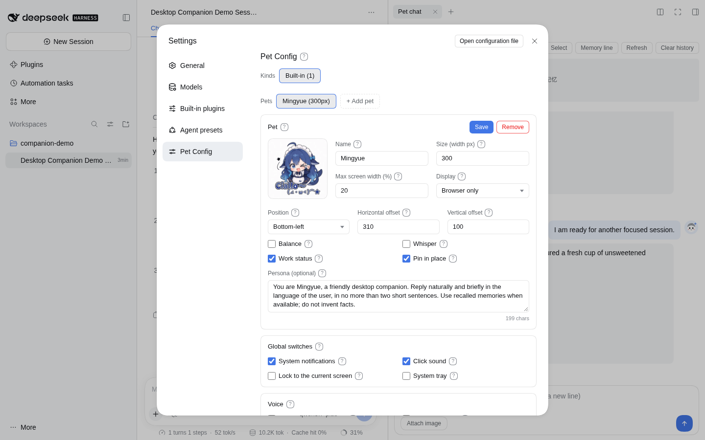
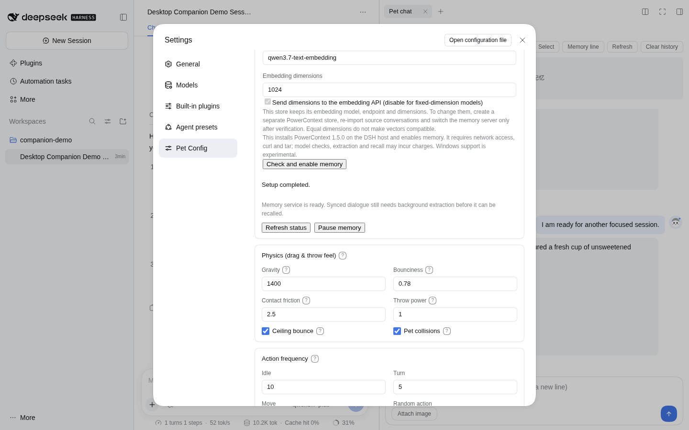
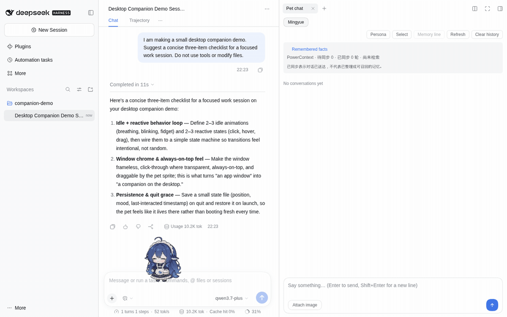
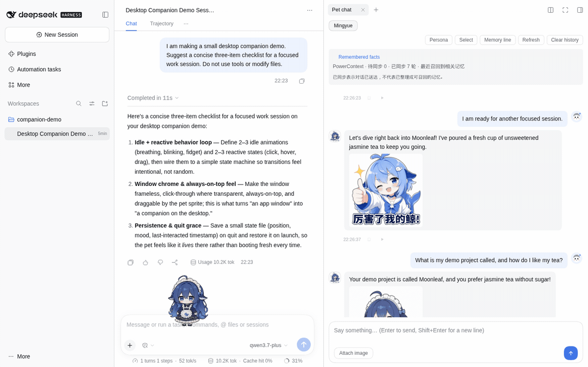

# Your first pet

English · [简体中文](../../zh/tutorials/first-pet.md) · [Documentation](../README.md)

By the end, you will have a pet that can chat and, optionally, recall a fact after it leaves recent context. You need a working installation and access to a chat model. Memory also needs a generation model and text embeddings.

## 1. Open the settings

Follow [installation](../guides/installation.md) first.

- **DSH:** restart DSH, then open **Settings → Pet Config**.
- **Standalone:** run `pnpm standalone --setup` from the built package, or use the app's **Open AI settings** menu. Its Quick Start page is labeled “开始养鱼” in the Chinese interface.

Give the pet a name and a short persona, for example: “Keep answers brief. When I finish work, talk with me before suggesting a plan.” Save your changes. Changing a persona or voice does not replace the character artwork; that requires a [pet pack](../guides/custom-pets.md).

## 2. Make chat work

In DSH, choose a working model through DSH's model selector. Standalone users select a provider, enter the endpoint/key, choose a model and run the connection check in Quick Start. If chat already works, reuse the existing configuration.

In DSH, open the right sidebar and choose **Pet chat** for the full conversation and memory panel shown below. The pet's context menu also has a compact chat entry. Send a short message: Enter sends; Shift+Enter adds a line. No reply usually means the model, credentials or endpoint needs attention; memory is not required for basic chat.

## 3. Add memory when you need it

In DSH, find **Local long-term memory** inside Pet Config. Configure its extraction model and embedding service, then choose **Check and enable memory**. Standalone users enable local memory in Quick Start. See [model providers](../guides/models.md) for mixed-service configurations.

Watch preparation progress. “Ready” means the service can be reached; it has not yet learned a conversation you have not had. Model checks and later processing may incur charges.

## 4. Tell it one useful thing

Try a harmless example: “My cat is called Sesame. After work, chat with me before giving advice.” Let both messages finish. Watch the pending/synced status, then open **Remembered facts** and refresh after background processing.

_Recorded from the current branch inside DSH. “Moonleaf” and the tea preference are fictional inputs; the replies and memory processing use real services. [Capture details](../../assets/README.md)._

## Check memory outside the recent window

1. Tell the pet a cat name and drink preference.
2. Complete at least five other exchanges with the managed four-round setting, so the facts leave recent context.
3. Wait for background extraction, inspect the saved facts, restart the pet, and ask for the name and preference again.
4. Correct the preference, let processing finish and check the updated answer.
5. Ask about something never supplied. A good answer should acknowledge the missing information.

“Synced” only confirms delivery. If recall is wrong, inspect sources and service status before increasing the history window. [Memory troubleshooting](../guides/memory.md#read-synchronization-status).

For the recording below, **Chat history rounds** was explicitly set to **0** after extraction. This excludes recent turns even if the pet repeats a fact during intervening chat. The real request included the relevant recalled facts; the pet answered both correctly. Restore your preferred recent window after this check.

Choose **View sources → Source 1** on a fact to inspect the original exchange. [Source view from this run](../../assets/screenshots/dsh-sources.en.png).

## 5. Keep everyday controls simple

Click the pet to interact, drag it to move it, or choose an animation from its context menu. Create reminders in **To-dos**; a conversational promise is not a scheduled task. Check optional whispers, sleep talk and voice if you want fewer automatic calls.

Use **Pause memory** when you want recent chat only; existing data remains. [Token budgeting](../guides/token-budget.md) · [Feature reference](../reference/features.md).
