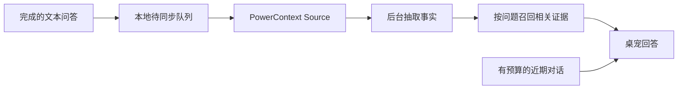
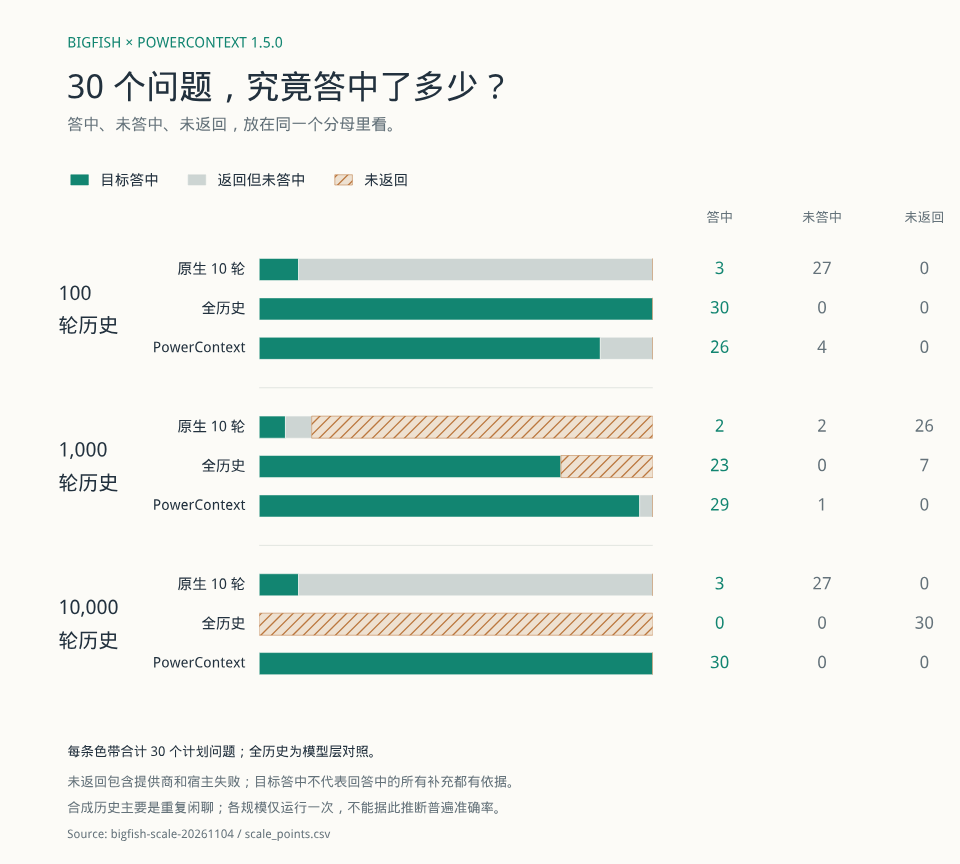
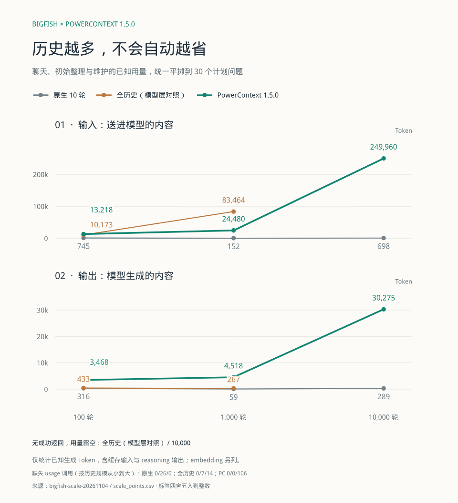
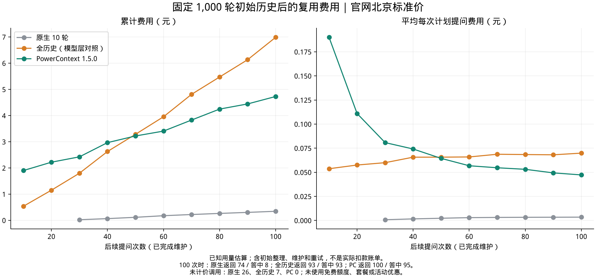

# 记忆、token 用量与费用

[English](../../en/explanation/memory-and-cost.md) · 简体中文 · [文档首页](../README.md)

**缩小近期窗口可以减少聊天输入；长期记忆可以找回旧事实，但抽取和维护同样消耗 token。** 应该比较的是：为了保留有用的记忆，完整工作负载花了多少。

## 桌宠怎样使用记忆

本地聊天存档、当轮近期上下文和长期记忆是三件事。原生模式默认带最近 10 轮，本地存档变大不会自动让每次请求变大。本机记忆首次设置采用近期 4 轮 / 6000 字节，以及单独的 4096 字节召回预算；这两项字节限制都不是总 token 限额。

## 结果从哪里来

以下数字和原图来自用户提供的《教你如何多快好省来养大肥鱼》第 13–17 页。报告使用真实独立桌宠、PowerContext 1.5.0 和 `qwen3.7-plus` 调用，语料是合成对话。本页整理报告中的结果，不代表本次重新跑了实验；仓库不包含完整原始日志和逐次调用账目。

“全历史”是每次携带累计对话的模型层实验对照，不是默认的原生 10 轮模式。“已知用量”不包含缺失 usage 的调用，未知不能按零计算。目标事实检查也不代表回答中的每一句补充都正确。

## 实验一：近期窗口与旧事实

每组加速回放 140 回合，按七个逻辑日组织，不是连续使用七天。五类事实各检查五次，提问前让事实退出近期窗口。

| 配置                        | 聊天输入 token | 窗口外已知事实答中 | 对未知事实承认不知道 |
| --------------------------- | -------------: | -----------------: | -------------------: |
| 原生近期 10 轮              |         78,396 |               2/25 |                  5/5 |
| 原生 4 轮 / 6000 字节       |         50,314 |               0/25 |                  5/5 |
| 相同近期预算 + PowerContext |         87,339 |              25/25 |                  5/5 |

小窗口减少了 **35.8%** 的聊天输入。加入记忆后找回了被检查的事实，但聊天输入也高于两个原生组。

总生成用量则是另一笔账：原生 10 轮的输入加输出为 183,476 token；关闭后台编码的记忆组，聊天与记忆处理的已知合计为 648,085 token，另有 Embedding 和一次缺失 usage 的调用。开启后台编码的另一配置也通过了 25 项事实和五项未知检查，并减少已知后台输入；该优化作用于后台处理，不是自动压缩每次桌宠聊天请求。

## 实验二：导入更多历史

分别导入 100、1000、10000 轮合成历史，每组提出 30 个计划问题。一轮历史包含双方消息。

_来源：PDF 第 15 页。绿色为目标答中，灰色为返回但未答中，橙色斜线为未返回。_

| 导入历史 | 原生：答中 / 返回 / 计划 | 全历史：答中 / 返回 / 计划 | PowerContext：答中 / 返回 / 计划 |
| -------: | -----------------------: | -------------------------: | -------------------------------: |
|   100 轮 |              3 / 30 / 30 |               30 / 30 / 30 |                     26 / 30 / 30 |
|  1000 轮 |               2 / 4 / 30 |               23 / 23 / 30 |                     29 / 30 / 30 |
| 10000 轮 |              3 / 30 / 30 |                 0 / 0 / 30 |                     30 / 30 / 30 |

_来源：PDF 第 16 页。包括聊天、初始整理和维护，统一除以 30 个计划问题；Embedding 另计，点位已四舍五入。_

| 历史轮数 | 原生输入 / 输出 | 全历史输入 / 输出 | PowerContext 输入 / 输出 |
| -------: | --------------: | ----------------: | -----------------------: |
|      100 |       745 / 316 |      10,173 / 433 |           13,218 / 3,468 |
|     1000 |        152 / 59 |      83,464 / 267 |           24,480 / 4,518 |
|    10000 |       698 / 289 |            不可用 |         249,960 / 30,275 |

千轮原生组有 26 次失败，低用量不能解释为效率提升。万轮全历史组碰到服务输入限制，没有成功返回。图中缺失 usage 的调用数，按规模递增分别为：原生 0/26/0，全历史 0/7/14，PowerContext 0/0/106。因此这些数字是已知部分，不是完整账单，也不代表失败调用免费。

这次实验没有证明“历史越多就越省”：导入更多历史，记忆整理和维护开销也明显增加。

## 实验三：复用固定记忆库

固定 1000 轮初始历史，随后提问 100 次，每十次等后台维护完成，计入初始整理、维护和重试。

_来源：PDF 第 17 页。绿色为 PowerContext，橙色为全历史，灰色为原生 10 轮。_

| 100 次计划提问后的指标 |    PowerContext |       全历史对照 |
| ---------------------- | --------------: | ---------------: |
| 已知生成输入           | 约 114 万 token | 约 1026 万 token |
| 已知费用估算           |           ¥4.73 |            ¥6.99 |
| 成功返回               |         100/100 |           93/100 |
| 目标检查通过           |          95/100 |           93/100 |
| 未计价调用             |               0 |                7 |

已知输入少 **88.9%**，已知费用估算低 **32.3%**，差额约 ¥2.26。每十次记录一次账，首次低于全历史的记录点是第 50 次，这不等于精确计算出了连续曲线的盈亏平衡点。记忆启动和初始整理约 ¥1.52，后续维护约 ¥2.70。

此实验的原生组返回 74/100，目标检查通过八次，另有 26 次未计价调用。全历史返回 93 次，返回的 93 次均通过目标检查，另有七次未计价调用。各组成功回答的问题集合不同，语料核心事实少、闲聊重复度高。**不能据此宣称同等质量下省了这些钱，也不能把该比例当作相对原生模式的节省。**

## 费用怎样估算

报告使用 **2026 年 11 月 5 日** 的北京标准按量价格，不扣优惠：`qwen3.7-plus` 单次输入不超过 25.6 万 token 时，普通输入 / 缓存输入 / 输出分别为每百万 token ¥2 / ¥0.4 / ¥8；`qwen3.7-text-embedding` 为每百万输入 token ¥0.5。

这些是报告采用的历史计价假设，不是当前价格建议，也不是实际扣款凭证。调用经过网关，上游地域与优惠无法确认。全历史输入有 84.1% 命中缓存，而 PowerContext 的生成输出约为其十倍，因此输入 token 的减少比例与估算费用的下降比例不同。

## 怎样用于自己的桌宠

先限制近期窗口。需要保留旧事实时启用记忆，再测整个工作负载：后台处理、输出、缓存、失败和回答质量一起看。可先按[用量控制指南](../guides/token-budget.md)调整，再做[退出近期窗口后的记忆检查](../tutorials/first-pet.md#验证窗口外的记忆)。
