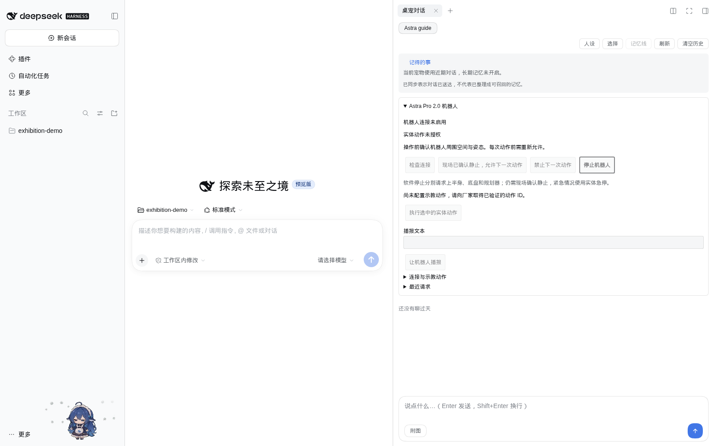
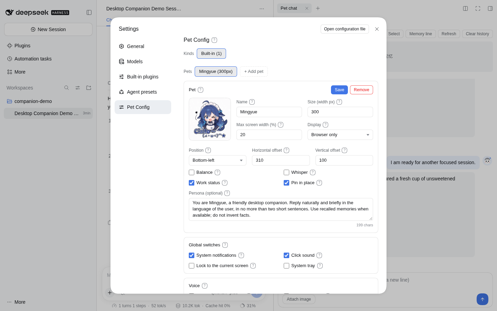
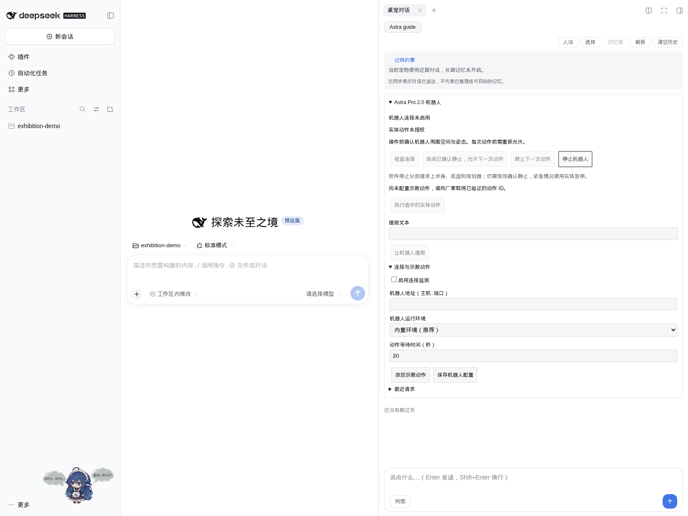

# 从安装桌宠到联动 Astra Pro 2.0

[English](../../en/tutorials/astra-first-interaction.md) · [文档首页](../README.md)

这份教程带你完成四件事：安装 dsh-pet、配置聊天、连接 Astra Pro 2.0，然后通过桌宠面板让机器人播报和执行厂家确认过的动作。

**适用版本：**包含机器人功能的 `slim` 预览包。2026-11-13 核对的构建来自提交 `faa9197`，五个平台均已通过构建验证。npm 已发布的 `0.1.0-beta.1` 和旧版 Windows ZIP 尚不包含机器人功能；不要用旧包完成本教程的机器人部分。预览包文件名也含 `0.1.0-beta.1`，请同时认准 **`slim` 后缀和构建来源**。

## 1. 先准备这些东西

| 准备项         | 需要什么                                                                                        |
| -------------- | ----------------------------------------------------------------------------------------------- |
| 运行桌宠的电脑 | Windows x64、Linux x64 / ARM64、macOS Intel / Apple Silicon；按这台电脑选包，不按机器人系统选包 |
| Astra Pro 2.0  | 厂家已完成开机检查、示教和现场调试的设备                                                        |
| 网络           | 运行桌宠或 DSH 的电脑能够访问机器人 gRPC 服务                                                   |
| 厂家接口信息   | 实际 IP / 主机名、gRPC 端口、已验证动作 ID、动作顺序、起始姿态与模式要求、停止后的恢复方法      |
| 聊天模型       | 想与桌宠聊天时，准备服务商、接口地址、模型 ID 和 API Key；仅操作机器人不需要模型密钥            |

可以把下面这句话发给厂家技术人员：

> 请提供本次展会 Astra Pro 2.0 的 gRPC 地址及端口、已验证的示教动作 ID 与执行顺序、每个动作的起始姿态和模式要求，以及软件停止、实体急停后的恢复方法；请安排现场人员配合首次联调。

不要直接照抄厂商示例代码里的 IP、端口和动作 ID。连接到同一 Wi-Fi 不代表 gRPC 一定可访问；如果 DSH 运行在服务器或容器中，需要**那台服务器或容器**能连接机器人。

## 2. 下载正确的安装包

打开[已验证的精简包构建](https://github.com/ob-labs/dsh-pet-powercontext/actions/runs/43197695059)，登录 GitHub，在页面的 **Artifacts** 区域下载对应文件。产物保留七天；过期后到 [Robot slim bundles 流水线](https://github.com/ob-labs/dsh-pet-powercontext/actions/workflows/robot-bundles.yml)选择新的成功构建，或请维护者重新运行。

| 电脑                          | 下载的 artifact           |
| ----------------------------- | ------------------------- |
| Windows x64                   | `robot-slim-win32-x64`    |
| Linux x64                     | `robot-slim-linux-x64`    |
| Linux ARM64                   | `robot-slim-linux-arm64`  |
| macOS Intel                   | `robot-slim-darwin-x64`   |
| macOS Apple Silicon（M 系列） | `robot-slim-darwin-arm64` |

先解压 GitHub 下载的 artifact ZIP。里面会看到安装包、运行环境包和体积报告：

- **Windows 独立桌宠：**使用 `dsh-pet-win32-x64-desktop-slim.zip`。
- **装进 DSH 或使用 Node 独立模式：**使用 `dsh-pet-powercontext-<版本>-<平台>-slim.tgz`；保留 `.tgz`，交给安装命令处理。
- `astra-runtime-<平台>-slim.tar.gz` 已包含在上述安装包内，无需再装一遍。
- Windows artifact 里的普通 `desktop.zip` 不含机器人内置环境；本教程选 `desktop-slim.zip`。

精简包包含独立 Python、Astra SDK 2.0.0 和控制依赖，不需要你另装 Python，也不会修改电脑已有的 Python。它不含 OpenCV、NumPy，不提供厂商摄像头预览和图像处理辅助功能。[安装包详情](../guides/robot-bundles.md)。

## 3. 安装桌宠：三条路线任选一条

### A. Windows 独立桌面版：不需要 DSH、Node.js

1. 将 `dsh-pet-win32-x64-desktop-slim.zip` **完整解压**到可写目录，例如 `D:\Apps\dsh-pet-astra`。
2. 打开其中的 `win-unpacked` 文件夹，双击 `dsh-pet.exe`。
3. 保留整个文件夹，包括 `resources`；不要只复制 EXE，也不要在压缩软件内直接运行。
4. 首次启动会打开 AI 设置。以后可以右键桌宠，选择 **打开 AI 设置**。

**看到什么算装好：**桌面出现角色，能够打开 AI 设置页。此时机器人连接默认关闭，电脑上的桌宠可以先独立使用。预览包未签名，Windows 可能显示信誉提示；先核对下载来源，不需要关闭系统防护。

### B. 装进已有的 DeepSeek Harness

这条路线需要已安装的 DSH。教程的 DSH 界面基于 **0.2.2-rc.1**，其 CLI 需要 Node.js **24.9+**；DSH 桌面应用用户先启动一次应用以初始化 profile，再完全退出后安装。

如果之前启用了上游 `dsh-pet`，先停用它，保留用户数据目录，避免两个桌宠插件争用相同路由和配置。

在终端执行对应命令。把示例中的**安装包路径**改成自己的实际路径。

Windows PowerShell，DSH 浏览器版：

```powershell
dsh plugin --profile web add "C:\Downloads\dsh-pet-powercontext-0.1.0-beta.1-win32-x64-slim.tgz"
```

Linux x64，DSH 浏览器版：

```bash
dsh plugin --profile web add "$HOME/Downloads/dsh-pet-powercontext-0.1.0-beta.1-linux-x64-slim.tgz"
```

Linux ARM64 和 macOS 改用对应平台的文件名。DSH 桌面应用把 `--profile web` 改成 `--profile desktop`。这些命令会让 DSH 处理本地包及插件启用；DSH 自身的依赖可能仍需要联网下载。

安装完成后重新启动 DSH：浏览器版按原来的方式启动（通常是 `dsh web`），桌面版重新打开应用。进入 **设置 → 桌宠配置**。首次使用时先添加并选择一个工作区，再点击 **打开右侧边栏 → Pet chat（桌宠对话）**；尚未选择工作区时，右侧栏入口可能不显示。机器人面板位于完整的桌宠聊天页，不在右键弹出的简易输入框里。

**看到什么算装好：**DSH 中出现桌宠，Pet chat 中可以找到 **Astra Pro 2.0 机器人**。下面是使用本教程精简包安装后拍摄的真实 DSH 页面；机器人尚未连接。



### C. Linux / macOS 等平台的 Node 独立模式

没有 DSH，也可以使用精简插件包独立运行。先准备 Node.js **22.12+**，创建一个用于安装应用的空文件夹，再执行：

```bash
mkdir astra-pet
cd astra-pet
npm install --offline --legacy-peer-deps "/absolute/path/dsh-pet-powercontext-0.1.0-beta.1-linux-x64-slim.tgz"
npx --no-install dsh-pet-powercontext --setup
```

将路径和平台改成自己的安装包。`--offline` 用于从本地包安装插件；聊天服务、首次显示桌面角色所需的 Electron 下载、可选记忆服务的安装仍可能需要联网。Windows 桌面 ZIP 已包含 Electron。

使用期间保持终端运行，按 `Ctrl+C` 退出。下次进入同一安装目录，执行最后一条命令即可。没有图形桌面的服务器不会出现桌面角色，可使用浏览器设置和聊天页面。Linux 包面向 glibc，不支持 Alpine/musl。

## 4. 配置桌宠，让它先能聊天

### DSH 插件用户

1. 在 DSH 中配置聊天服务商和模型，通过宿主的模型选择器选择可用模型。
2. 进入 **设置 → 桌宠配置**，设置名称、大小、显示位置和人设。
3. 打开右侧 **Pet chat**，选择要互动的宠物，发送“你好，请用一句话介绍自己”。

聊天默认沿用 DSH 当前模型；机器人连接不使用这个 API Key。可以把人设写成：“你是展台讲解伙伴，回答简短清楚；不要声称已经执行了未经操作员确认的实体动作。”人设只影响回复，实体动作仍由面板按钮控制。



### Windows / Node 独立模式用户

1. 打开 **AI 设置 → 开始养鱼**。已有可用配置时可以选择 **沿用当前聊天配置**。
2. 在 **聊天服务商** 中选择 DeepSeek、OpenAI、通义千问、硅基流动、Ollama、LiteLLM 或自定义兼容服务等预设。
3. 核对 **聊天接口地址**，填写该服务对应的 **聊天 API 密钥**。
4. 点击 **获取模型列表**，选择账户可用模型，也可以直接填写模型 ID。获取到列表不代表一定有调用权限。
5. 首次先不勾选长期记忆，点击 **开始养鱼** 完成连接检查。通过后点击 **去聊天**，或切换到设置页的聊天标签。
6. 发送一条短消息，确认能收到回复。换服务地址后需要重新填写该地址对应的 Key。

不需要填写某一家固定的模型名。Ollama 需要提前安装并下载模型；LiteLLM 预设不会替你安装网关。更多说明见[模型配置](../guides/models.md)。

### 可选：长期记忆和电脑语音

PowerContext 用于记住成功聊天中出现的偏好和信息，**不是机器人控制的前置条件**。需要时再配置记忆整理模型与文本 Embedding，核对向量维度并启用。机器人包里的 Python/SDK 不等于已安装 PowerContext；记忆服务单独准备，Windows 自动安装仍为实验性支持。[记忆配置步骤](../guides/memory.md)。

桌宠在电脑上的回复语音，与机器人扬声器播报是两套功能。电脑语音在桌宠语音设置中配置；机器人播报使用后面的 **让机器人播报** 按钮。聊天回复不会自动转发到机器人扬声器。

## 5. 接入 Astra Pro 2.0

1. 让厂家确认机器人已开机，2.0 gRPC 服务已启动，电脑到服务端口的网络可达。
2. 在完整桌宠聊天页展开 **Astra Pro 2.0 机器人**，再展开 **连接与示教动作**。
3. 按下表填写，先不添加动作也可以检查连接。

| 面板项目                | 怎么填                                                                                                 |
| ----------------------- | ------------------------------------------------------------------------------------------------------ |
| 启用连接监测            | 勾选；只开启状态监测，不会自动授权动作                                                                 |
| 机器人地址（主机:端口） | 填厂家提供的实际 `IP:端口` 或 `主机名:端口`，不要加 `http://`、`https://` 或 `/` 路径；当前不支持 IPv6 |
| 机器人运行环境          | 选择 **内置环境（推荐）**，不需要再指定系统 Python                                                     |
| 动作等待时间（秒）      | 默认 30，允许 3–120 的整数；这是等待接口响应的时间，不是指定动作时长                                   |

4. 点击 **保存机器人配置**。提示“配置已保存，控制已禁用；请检查连接”是正常现象，表示动作授权被清除。
5. 点击 **检查连接**。成功后显示 **已连接**，并显示控制器返回的描述。检查连接只读状态，不切换模式、不驱动动作。



启用后约每五秒读取一次状态，超过 15 秒没有有效新状态会视为过期。**已连接不等于可以执行动作**：动作还要求控制器处于空闲码 `520000`，躯干、左臂、右臂模式均为 `1`。由厂家人员通过厂家工具确认和切换模式；桌宠面板不会自动切入自动模式。

## 6. 第一次互动：先播报，再执行一个动作

### 先让机器人说一句话

1. 确认面板显示 **已连接**，且没有其他应用请求正在执行。
2. 在 **播报文本** 中填写：“你好，欢迎来到我们的展台。”文本最多 500 个字符。
3. 点击 **让机器人播报**。
4. 展开 **最近请求** 查看响应，并在现场听机器人是否实际出声。

播报不需要点击动作授权按钮，但仍需你明确点击发送。如果此前允许了一次动作，发送播报也会清除该授权。接口成功只表示播报请求被接受，不代表声音已经播放完毕。

### 添加一个厂家验证过的示教动作

1. 展开 **连接与示教动作**，点击 **添加示教动作**。
2. **动作名称**填写便于识别的名称，例如“展台欢迎”。这只是面板名称，不会让机器人自动学习一个新动作。
3. **厂家确认的动作 ID**填写该机器人上已经验证过的数字编号；不要把“挥手”之类文字当成 ID。
4. **联动桌宠动画名称**先留空，让首次验证只关注机器人动作。
5. 点击 **保存机器人配置**，然后重新 **检查连接**。

需要动作序列时，在同一行填写厂家确认的多个 ID，用英文逗号分隔。应用将按填写顺序提交给 2.0 动作管理接口；每行最多 32 个 ID，最多配置 20 行。第一次联调先使用厂家确认的单动作。

### 执行动作

1. 在操作区的 **动作名称**下拉框中选择刚保存的动作。
2. 由现场人员确认机器人静止，当前姿态和周围空间符合该动作要求。
3. 点击 **现场已确认静止，允许下一次动作**，看到 **已允许一次动作**。
4. 点击 **执行选中的实体动作**，观察机器人，同时查看 **最近请求**。
5. 下一次操作前重新检查状态并允许一次动作。一次请求消耗一次授权，保存配置、重启或连接异常也会撤销授权。

| 最近请求的状态 | 含义与下一步                                                       |
| -------------- | ------------------------------------------------------------------ |
| 等待控制器响应 | 请求已经发出，等待结果；不要重复点击                               |
| 控制器报告成功 | 控制器接口返回成功；仍需现场确认机器人实际动作及结束状态           |
| 请求失败       | 阅读错误信息，核对配置或厂家控制器信息后处理                       |
| 执行状态待确认 | 可能已经执行但没有收到结果；先检查机器人，不能直接重新发送同一动作 |

## 7. 让桌宠与机器人互相反馈

### 从桌宠面板控制机器人，并播放桌宠动画

先确认实体动作运行正常，再编辑该动作行的 **联动桌宠动画名称**，填写当前宠物实际配置中的动画名称。可以从[角色配置与动画说明](../reference/configuration.md)核对；名称必须完全一致，换一个角色后要重新核对。

保存并重新检查连接，再授权、执行动作。应用在**提交动作请求时**触发所选桌宠动画，并显示请求及回执气泡。这不是实体机器人动作完成的传感器反馈；机器人失败或超时，桌宠也可能已经播放动画。

### 从机器人状态变化反馈到桌宠

保持 **启用连接监测**，由厂家人员使用厂家工具操作机器人。如果控制器返回的**状态描述发生变化**，桌宠会显示 `Robot: …` 状态气泡；描述没变化就不会产生新的状态气泡。

当前不能识别外部设备执行的具体动作 ID，也不能让桌宠逐个模仿任意手势。普通聊天、自动碎碎念和模型输出不会自动下发实体动作，机器人操作也不会自动写入 PowerContext 记忆。

## 8. 停止与结束演示

- **只想取消下一次动作许可：**点击 **禁止下一次动作**。这不会停止已经在运行的实体动作。
- **需要请求停止机器人：**点击 **停止机器人**。即使动作请求尚未返回，该按钮仍可使用；面板分别显示 `planner`（规划器）、`upperBody`（上半身）和 `agv`（底盘）的响应。
- **遇到现场紧急情况：**使用机器人实体急停，并按厂家指引处理。软件显示 `ACK` 只代表子系统响应，仍需现场确认机器人静止；断网时软件停止可能无法送达。

停止后由厂家人员恢复姿态和模式，再重新检查连接、重新授权。程序不会自动恢复模式，也不会自动重放未确认动作。

结束演示时先确认机器人已经安全停止，撤销动作许可，再退出桌宠或 DSH。不要把关闭网页、结束进程或断电当成停止机器人。只想继续使用普通桌宠时，可以取消勾选 **启用连接监测**并保存；这不是停止指令。

## 9. 常见问题

| 现象                          | 先检查什么                                                                                                    |
| ----------------------------- | ------------------------------------------------------------------------------------------------------------- |
| 找不到机器人面板              | 是否安装了 `slim` 预览包，是否重启了宿主，是否打开完整 Pet chat；旧 npm beta 和简易聊天弹窗没有这个面板       |
| `dsh` 命令不存在              | 该路线需要 DSH CLI；可以用 Windows 独立桌面包，或完成 DSH 自身安装后再安装插件                                |
| `bundled_runtime_unavailable` | 是否选对宿主平台，是否保留整个安装目录，是否误装普通包；不要改选系统 Python 来碰运气                          |
| 未连接或状态已过期            | 地址、端口、网络和防火墙是否正确，厂家 gRPC 服务是否开启；从运行 DSH 的机器检查，而不是只在浏览器所在电脑检查 |
| 已连接，但允许动作按钮不可用  | 可能还在处理请求，或空闲码 / 三个模式不符合要求；请厂家工具核对，再点击检查连接                               |
| 没有可选动作                  | 尚未添加并保存厂家验证的动作 ID                                                                               |
| 机器人播报成功但没声音        | 接口响应不是播放完成回执；现场检查厂家语音服务、音量和扬声器                                                  |
| 实体动作超时                  | 超时不表示机器人已停止；先现场确认状态，再决定停止或恢复，应用不会自动重试                                    |
| 桌宠说“我挥手了”，机器人没动  | 聊天不会自动控制机器人，必须使用机器人面板的动作按钮                                                          |
| 桌宠动画不播放                | 核对动画名称和当前角色素材；桌宠动画失败不改变已下发的实体指令                                                |

配置和回执位于用户数据目录 `$DSH_HOME/dsh-pet/`；未指定 `DSH_HOME` 时使用宿主默认目录。不要为了修复问题直接删除整个目录。[配置、数据与故障说明](../guides/robot.md#数据位置与常见问题)。

## 10. 本教程验证到了哪里

五个平台的精简包已验证隔离 Python、真实 SDK 协议模块、离线安装与本地模拟 gRPC 调用；Windows ZIP 已验证实际 Electron 启动。此次教程额外在独立目录实测了 **DSH 安装本地精简包和机器人面板显示**。

两张机器人面板截图来自实际 DSH 浏览器页面，保持未连接、未配置动作的状态；没有模拟真机成功回执。外观设置图是已有的 DSH 实录，版本与来源见[素材说明](../../assets/README.md)。**这些验证不等于实体机器人联调**：固件兼容、实际动作、播报效果和停止行为，仍需在展会设备上按厂家指引逐项确认。

进一步阅读：[机器人功能说明](../guides/robot.md) · [精简包说明](../guides/robot-bundles.md) · [模型配置](../guides/models.md) · [PowerContext 记忆](../guides/memory.md)。
