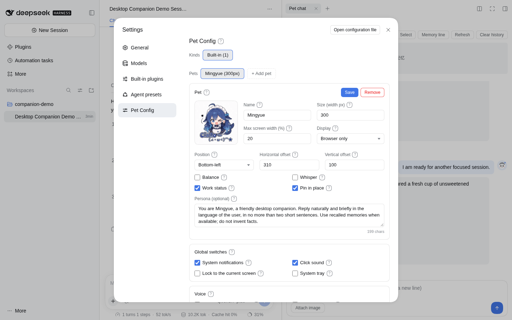
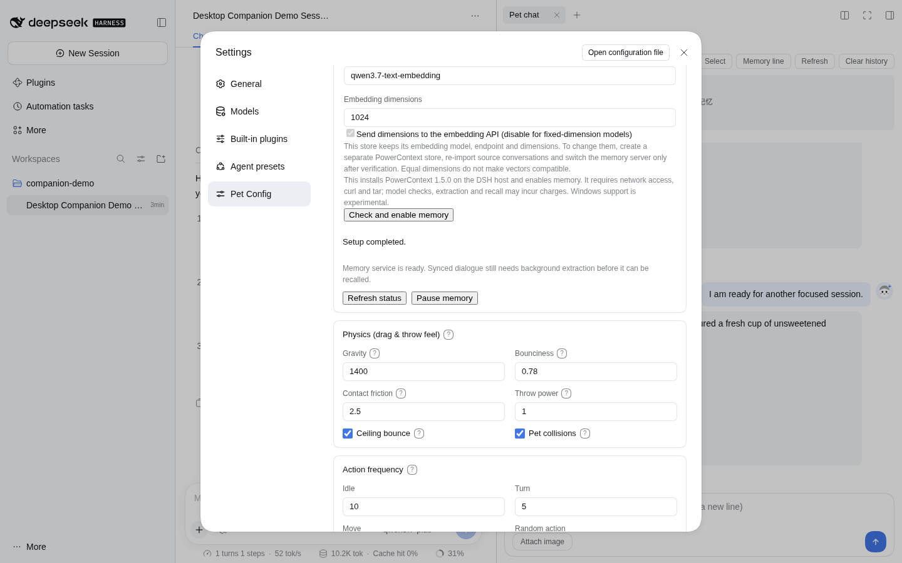
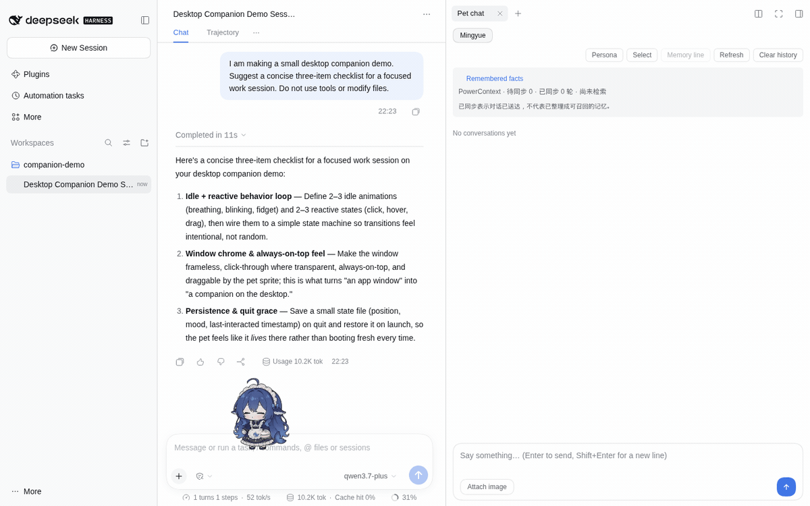
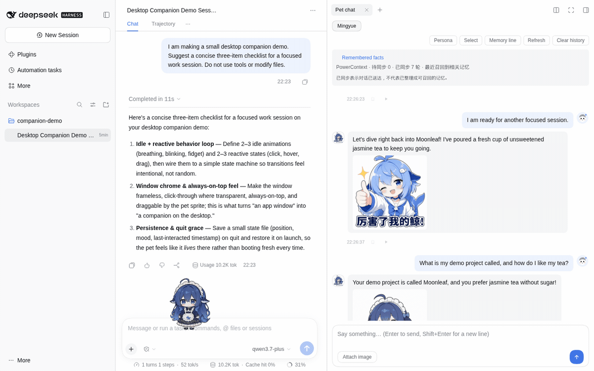

# 养好第一只桌宠

[English](../../en/tutorials/first-pet.md) · 简体中文 · [文档首页](../README.md)

跟着本页先让桌宠正常聊天，再按需验证一条退出近期窗口后的记忆。需要已完成安装，并有可用的聊天模型；长期记忆还需要生成模型与文本 Embedding。

## 1. 打开设置

先完成[安装指南](../guides/installation.md)。

- **DSH：**重启后打开「设置 → 桌宠配置」。
- **独立模式：**在构建后的包目录执行 `pnpm standalone --setup`，或在角色菜单选择「打开 AI 设置」，进入「开始养鱼」。

给她起个名字，写一句具体的人设，例如：“回答短一些，我下班来找你时先陪我聊两句，再考虑给建议。”保存后继续。改人设或音色不会更换角色外形，换外形需要[宠物包](../guides/custom-pets.md)。

## 2. 先让聊天正常工作

DSH 用户通过宿主的模型选择器选一个能用的模型。独立模式用户在开始养鱼中选择服务商、填写地址和 Key、选择模型，再检查连接；已有可用聊天配置时可以直接沿用。

在 DSH 中展开右侧栏，选择「Pet chat（桌宠对话）」，即可进入下图的完整聊天与记忆面板。右键桌宠的「对话」也可打开简易输入框。发送一句短消息：Enter 发送，Shift+Enter 换行。没有回复时先检查模型、凭据和接口地址；基本聊天不需要长期记忆。

## 3. 按需开启记忆

DSH 用户在桌宠配置中找到「本机长期记忆」，分别配置记忆整理模型和 Embedding，再点「检查并启用记忆」。独立模式用户在开始养鱼中勾选本机记忆。混用不同服务商时参考[模型配置](../guides/models.md)。

观察准备进度。“就绪”表示服务已经可以访问，不代表它已读过你还没说的话。模型检查和后续处理可能产生费用。

## 4. 教她记住一件小事

可以使用无敏感信息的示例：“我的猫叫芝麻，下班后先陪我聊两句，别直接列计划。”等双方问答结束，查看待同步 / 已同步状态，再在后台整理后打开「记得的事」并刷新。

_当前分支在 DSH 中的实际录屏。Moonleaf 和饮品偏好是虚构输入，回复及记忆处理均调用真实服务。[录制说明](../../assets/README.md)。_

## 验证窗口外的记忆

1. 告诉桌宠猫名和饮品偏好。
2. 在默认四轮近期设置下，再完成至少五轮其他话题，让信息退出近期窗口。
3. 等后台抽取、检查已保存事实，重启桌宠，再问猫名和偏好。
4. 改口一次，等处理完成，再检查是否采用了新偏好。
5. 问一件从未提供的信息，看她能否承认不知道。

“已同步”只证明对话送达。回答不对时先查来源和服务状态，再考虑增加历史轮数。[同步状态与恢复](../guides/memory.md#同步状态与恢复)。

下方录屏在抽取完成后，将「Chat history rounds（对话历史条数）」明确设为 **0**，排除了中间聊天重复提到事实的影响。实际请求携带相关召回记忆，桌宠答对了两项。验证后可以恢复自己习惯的近期窗口。

在事实条目中点「View sources → Source 1」，可以检查原始对话。[本次运行的来源视图](../../assets/screenshots/dsh-sources.en.png)。

## 5. 用好日常控制

点击角色互动，拖拽移动，或在右键菜单点播动作。需要提醒时在「待办事项」创建条目，聊天中的承诺不等于任务。希望减少自动调用时，检查碎碎念、梦话和语音开关。

只想用近期聊天时点击「暂停记忆」，已有数据仍保留。[用量控制](../guides/token-budget.md) · [功能参考](../reference/features.md)。
